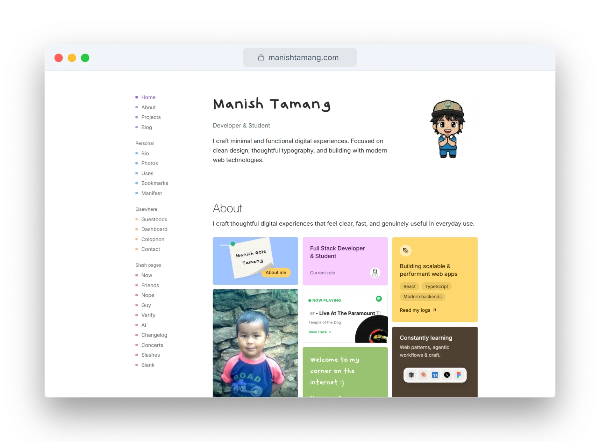

<div align="center">

# Manish Tamang - Personal Portfolio V5

Welcome to my personal portfolio website, a showcase of my professional journey, technical skills, and creative endeavors. Rebuilt in Astro, pages ship as plain HTML with almost no JavaScript.

[](https://astro.build/) [](https://www.typescriptlang.org/) [](https://tailwindcss.com/) [](https://supabase.com/) [](https://www.postgresql.org/) [](https://www.better-auth.com/) [](https://resend.com/) [](https://vercel.com/) [](./LICENSE)

Live site: [manishtamang.com](https://manishtamang.com)

</div>

<p align="center">
  
</p>

## Commands

| Command | Description |
| --- | --- |
| `pnpm dev` | Dev server |
| `pnpm build` | Static build to `dist/` |
| `pnpm preview` | Serve the build |
| `pnpm check` | Type-check `.astro` and `.ts` files |
| `pnpm check:urls` | After a build: fail if any old-site URL is missing |

Open `/design-system` to see every token and component on one page.

## Structure

```
src/
  styles/
    tokens.css        colors (light/dark), type scale, widths, radius, motion — change taste here
    global.css        Tailwind + base element styles
    prose.css         long-form typography for MDX (.prose)
  components/
    layout/           Head (SEO, font, theme), Header, Footer, Container, ThemeToggle
    typography/       Heading, Text, Prose
    ui/               Button, Link, Badge, Card, Separator, Input, Textarea, Kbd
  layouts/
    BaseLayout.astro  html shell
    PageLayout.astro  shell + page heading/intro
  data/
    slash-pages.ts    content for /nope /guy /verify /ai /changelog /concerts /blank (sample: true = placeholder)
  lib/
    site.ts           site config and navigation
    routes.ts         URL inventory from the old site (pages, slugs, API endpoints)
  pages/              one file per legacy URL, plus sitemap.xml, robots.txt, feed.xml, llms.txt
migration/
  sitemap-urls.txt    snapshot of the live sitemap (66 URLs) used by check:urls
```

## Conventions

- Components use semantic tokens only (`bg-background`, `text-muted-foreground`, `border-border`), never raw colors.
- Style direction: modelled on recurse.com — Inter (cv05, ss03), purple accent (#966bc3), yellow selection, bold h1 / ultralight h2, pill buttons, highlighted pull quotes.
- Fonts via Astro's Fonts API: Inter (self-hosted, only upright Latin preloaded) and MyFont (`font-display`, the handwritten name face).
- Dark mode: `.dark` on `<html>`, same `theme` localStorage key as the old site.
- URLs: `trailingSlash: "never"` + `build.format: "file"`, so `/about` stays `/about`.

## Migration status

- [x] All 14 pages, 23 blog slugs, 29 project slugs, sitemap/robots/feed/llms.txt
- [x] Blog: 23 posts migrated from Sanity to MDX in `content/blog/<slug>/` (`scripts/migrations/migrate-blog.mjs`)
- [ ] Projects: content collection replacing `legacyProjectSlugs`
- [ ] Vercel adapter + API endpoints listed in `lib/routes.ts` (keep `/api/now-playing/svg` and `/api/wakatime/callback` paths)
- [ ] `/guestbook` OG image
- [ ] Mobile nav (header links are hidden below `sm`; footer has them for now)

## Project structure

```text
assets/         Images and fonts processed at build time
components/     UI, grouped by feature (home/<section>, guestbook, dashboard, ...)
  layout/       Site chrome: sidebar, footer, head
  ui/           Generic building blocks: Button, Link, Badge
  icons/        One SVG per component
content/        Blog posts and projects, each folder with its images
data/           Editable site content (bookmarks, uses, about, ...)
layouts/        Page shells
lib/            Logic with no markup
  services/     External APIs: Supabase, Last.fm, Umami, WakaTime, daily.dev
  blog/         Posts and view counts
  guestbook/    Entries, emails and SEO
  client/       Larger browser scripts
pages/          Routes, one folder per URL (pages/about/index.astro is /about)
public/         Files served as they are
scripts/        Maintenance scripts; one-off imports live in migrations/
styles/         Tokens, base styles and prose
```

`/guestbook` and `/dashboard` render per request, so anything they share (like the footer) must not use `<Image>`. Production has no `/_image` route.
