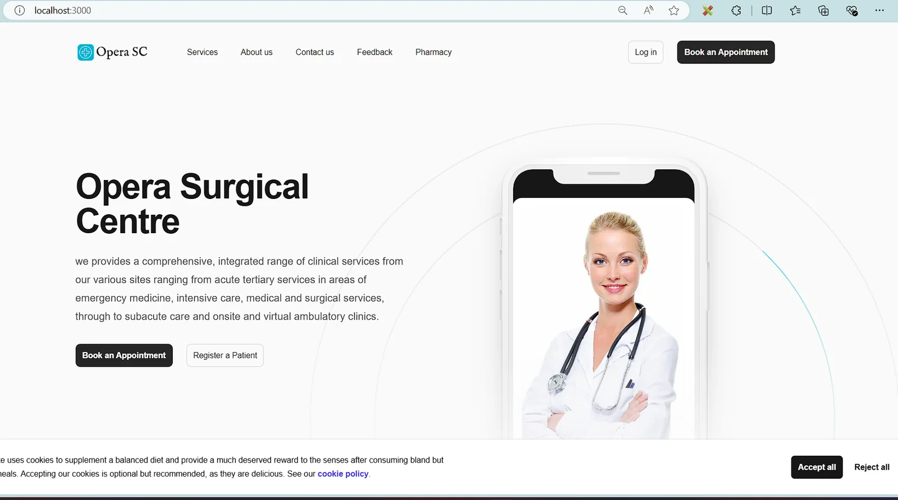
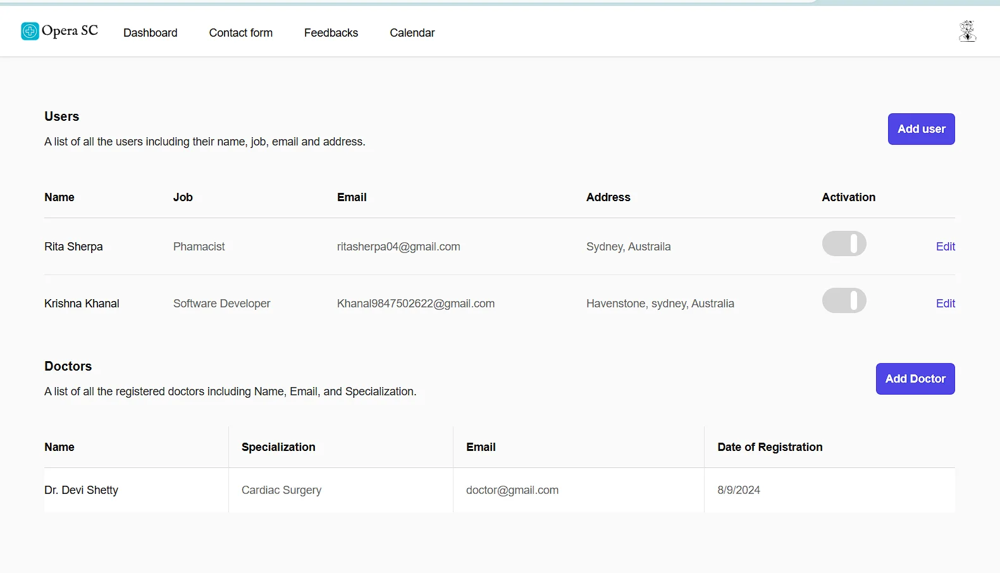

## The Spark That Started It All

My journey into web development began long before I wrote my first line of code. At 12, I was already fascinated by computers and technology, spending hours solving QBasic questions and working through algorithms and flowcharts from my 7th-grade computer book. The spark was there from the very beginning, but it would take a couple more years before it truly ignited.

## The Challenge That Changed Everything

Everything changed in late 2022 when I was 14 and in 9th grade. My computer teacher, Milan Sunuwar, noticed my enthusiasm and presented me with a challenge that would shape my entire career path: "Manish, you're very good at computers. Why don't you dare to make a website for our school, Prashanti Academy?"

With the confidence only a 14-year-old can muster, I replied, "Sure sir, why not!"

But reality hit hard. I thought I knew what a website was – after all, I'd read in my computer book for years that "a website is a collection of webpages." What I didn't know was how to actually build one, what HTML really was, or how any of it worked in practice.

## The Learning Begins

Determined not to give up, I teamed up with my friend Sajak Dhital (who has since left coding) to tackle this school website project. Like most beginners, I started by copying a template and proudly showing it to my teacher.

Then came the question that opened my eyes: "How can I upload content to this?"

That's when it hit me – I had no idea how to make the website editable without constantly updating the code. And wait, I hadn't even thought about hosting! I was literally showing my "prashanti.html" file from a USB drive plugged into my teacher's computer.

The chaos, wonder, and hunger for learning that followed would define the next phase of my journey.

## Finding Solutions in a Pre-ChatGPT World

This was still November 2022, and ChatGPT hadn't been released yet. With multiple doubts and seemingly no answers, I had to dig deep to find solutions. That's when I discovered Sanity.io, a content management system that could handle dynamic content uploads.

Now the real challenge began: how do I integrate this "chunky, colorful code" into my basic HTML to make the website dynamic?

## The Deep Dive into React and Next.js

This quest led me to learn Next.js and React.js simultaneously during my 10th grade. I was building things that worked, but honestly, I had no idea what I was doing or why it was working. Those red error messages would haunt me for weeks until ChatGPT finally arrived and casually suggested using `--force` to install npm packages.

## The Breakthrough Period

After passing my SEE (Secondary Education Examination) boards in 10th grade, I had a golden three-month holiday. I used this time to sharpen my Next.js skills and dive deep into frontend UI development.

This period also saw me connecting with people online through Instagram, GitHub, LinkedIn, and my portfolio website (formerly manishtamang.xyz). I started creating content on Instagram, and my reels began getting serious traction – 6,000+ views with an average of 3,000+ views per reel.

A huge part of this success was thanks to Swikar Sharma, a software developer with 30,000+ followers who created coding reels. He would share my videos in his stories, helping me reach a wider audience and build my online presence.

## The First Client Message

Then came August 2024 – the month that changed everything. A message popped up from a Nepali guy living in Australia asking if I could handle assignment work for bachelor's students. When I asked what kind of assignments, he mentioned management systems like hospital management systems.

I took on the project with determination and completed it in two weeks. The payment? 355 Australian dollars – my first-ever payment for coding work.

here are some snippets of the project and the code is still available in github

<figure>

</figure>

<figure>

</figure>

## The Validation I Needed

Receiving that payment was more than just money; it was validation that my skills had real worth in the market. At 16, I had successfully completed a project for a client thousands of miles away and been paid for it.

This moment gave me the motivation to continue pushing forward, knowing that the countless hours spent debugging, the weeks of confusion, and the persistent learning had all been worth it.

## Looking Forward

That first client experience taught me that age is just a number when you have the skills and determination to solve problems. It showed me that the journey from curious kid to paid developer is possible, even when you're still figuring things out as you go.

The path wasn't linear, and there were many moments of doubt and confusion. But every challenge became a learning opportunity, every error message became a puzzle to solve, and every small victory built the foundation for bigger achievements.

From copying templates to building dynamic websites, from wondering how to host a site to earning my first payment – this journey has been the most rewarding experience of my young life. And this is just the beginning.

*This is just a glimpse into my coding journey. I'll be sharing more detailed stories and technical insights on my blog, so stay tuned for more adventures in web development!*
