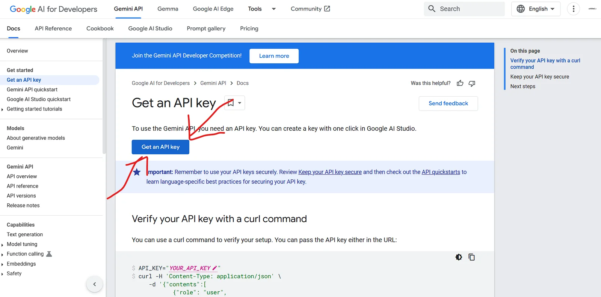
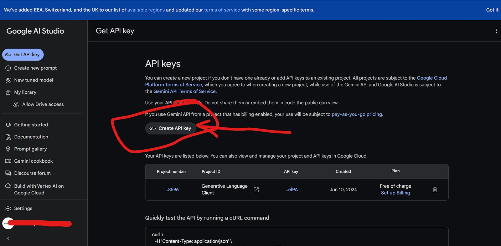

## Gemini Chatbot Code Documentation

This documentation provides an overview of a React-based chatbot application using the Gemini Language Model API. The chatbot interface allows users to type questions and receive generated responses.

## Quick Preview

\<iframe\
  src="https://manishtamang.tech/"\
  style=\{\{\
    width: '100%',\
    height: 'auto',\
    aspectRatio: '16 / 9',\
  \}\}\
  title="Live Preview"\
/\>

## Components and Functions

### Imports

```jsx
import { useState, useEffect } from "react";
import axios from "axios";
import ReactMarkdown from "react-markdown";
import { Input } from "@/components/ui/input";
import { Button } from "@/components/ui/button";
```

- `useState` and `useEffect` are React hooks for state management and side effects.
- `axios` is used for making HTTP requests.
- `ReactMarkdown` renders markdown content.
- `Input` and `Button` are custom UI components.

### State Variables

```jsx
const [question, setQuestion] = useState("");
const [messages, setMessages] = useState([]);
const [generatingAnswer, setGeneratingAnswer] = useState(false);
```

- `question`: Stores the current input question from the user.
- `messages`: Keeps track of the chat messages between the user and the bot.
- `generatingAnswer`: Indicates if the bot is currently generating an answer.

### `useEffect` Hooks

**Load Messages from Local Storage**

```jsx
useEffect(() => {
  const savedMessages =
    JSON.parse(localStorage.getItem("chatMessages")) || [];
  setMessages(savedMessages);
}, []);
```

- Loads previously saved messages from `localStorage` when the component mounts.

**Save Messages to Local Storage**

```jsx
useEffect(() => {
  localStorage.setItem("chatMessages", JSON.stringify(messages));
}, [messages]);
```

- Saves messages to `localStorage` whenever the messages state changes.

### How to get Gemini API key?

At first go to [here](https://ai.google.dev/gemini-api/docs/api-key?authuser=1)

<figure>



</figure>

It will look like the below image:\

Click on the **Get an API Key** as shown in the picture.

<figure>



</figure>

Then it will redirect you to another page as shown in below image:\

Click on **Create API key** and copy the given api Key then Paste it in .env file (Remember to rename .env.example file as .env)

```dotenv
NEXT_PUBLIC_API_GENERATIVE_LANGUAGE_CLIENT=XXXXXXXXXXXXXXXXXXXXXXXX
```

### `generateAnswer` Function

```jsx
async function generateAnswer(e) {
  setGeneratingAnswer(true);
  e.preventDefault();
  const newMessage = { sender: "user", text: question };
  setMessages((prev) => [...prev, newMessage]);
  setQuestion("");
  
  try {
    const response = await axios({
      url: `https://generativelanguage.googleapis.com/v1beta/models/gemini-pro:generateContent?key=${process.env.NEXT_PUBLIC_API_GENERATIVE_LANGUAGE_CLIENT}`,
      method: "post",
      data: {
        contents: [{ parts: [{ text: newMessage.text }] }],
      },
    });

    const botMessage = {
      sender: "bot",
      text: response.data.candidates[0].content.parts[0].text,
    };
    setMessages((prev) => [...prev, botMessage]);
  } catch (error) {
    console.log(error);
    const errorMessage = {
      sender: "bot",
      text: "Sorry - Something went wrong. Please try again!",
    };
    setMessages((prev) => [...prev, errorMessage]);
  }

  setGeneratingAnswer(false);
}
```

- Handles the submission of a user's question.
- Prevents the default form submission behavior.
- Adds the user's question to the messages state.
- Sends the question to the Gemini API to get a response.
- Adds the bot's response to the messages state.
- Handles errors by logging them and displaying an error message.
- Disables the generating answer state when done.

### JSX Structure

**Main Container**

```jsx
<div className="flex items-center justify-center h-screen bg-gray-100 dark:bg-gray-900">
```

- Centers the chatbot vertically and horizontally on the screen with background color.

**Chat Window**

```jsx
<div className="flex flex-col h-[90vh] max-w-md w-full bg-white dark:bg-gray-950 rounded-2xl shadow-lg overflow-hidden">
```

- Creates a vertical layout with defined height and width, and applies styles for the chat window.

**Header**

```jsx
<header className="bg-gray-100 dark:bg-gray-900 px-4 py-3 flex items-center gap-3">
 <svg
            xmlns="http://www.w3.org/2000/svg"
            viewBox="0 0 256 256"
            fill="currentColor"
            className="w-6 h-6"
          >
            <path d="M230.92 212c-15.23-26.33-38.7-45.21-66.09-54.16a72 72 0 1 0-73.66 0c-27.39 8.94-50.86 27.82-66.09 54.16a8 8 0 1 0 13.85 8c18.84-32.56 52.14-52 89.07-52s70.23 19.44 89.07 52a8 8 0 1 0 13.85-8ZM72 96a56 56 0 1 1 56 56 56.06 56.06 0 0 1-56-56Z"></path>
          </svg>
  <div className="text-lg font-medium">Chatbot</div>
</header>
```

- Displays the chatbot header with a title and icon.

\***Message List**

```jsx
<div className="flex-1 overflow-y-auto p-4 space-y-4">
  {messages.map((msg, index) => (
    <div key={index} className={`flex ${msg.sender === "user" ? "justify-end" : "justify-start"}`}>
      <div className={`${msg.sender === "user" ? "bg-blue-500 text-white" : "bg-gray-100 dark:bg-gray-800"} px-4 py-3 rounded-2xl max-w-xs`}>
        <ReactMarkdown>{msg.text}</ReactMarkdown>
      </div>
    </div>
  ))}
</div>
```

- Displays the list of messages with conditional styling based on the sender (user or bot).
- Uses `ReactMarkdown` to render message text.

**Input Form**

```jsx
<form onSubmit={generateAnswer} className="flex items-center gap-2 p-4 bg-gray-100 dark:bg-gray-900">
  <Input
    type="text"
    placeholder="Type your message..."
    className="flex-1 bg-transparent"
    value={question}
    onChange={(e) => setQuestion(e.target.value)}
    disabled={generatingAnswer}
  />
  <Button
    type="submit"
    variant="ghost"
    size="icon"
    className="text-blue-500"
    disabled={generatingAnswer}
  >
    Send
  </Button>
</form>
```

- Handles user input and form submission.
- Disables input and button while waiting for the bot's response.
- Uses Input and Button components with styles and interactivity.

## Summary

This React component creates a chatbot interface that saves chat history to local storage and interacts with the Gemini Language Model API to generate responses to user questions. The component is structured with a header, message list, and input form, and includes error handling and state management for a responsive user experience.

Repo Link : [Github](https://github.com/Manish-Tamang/gemini-bot)
