A curated collection of powerful and customizable UI component libraries for React and Next.js applications. These libraries provide pre-built components to accelerate your development process while maintaining high-quality, responsive designs.

## Featured Libraries

### Aceternity UI

Aceternity UI offers a collection of trendy and easy-to-use components and templates for building websites with Tailwind CSS and Framer Motion. Modern UI components with stunning animations and effects. Perfect for creating engaging, interactive user experiences.

- **Highlights**: Tailwind CSS based, beautiful animations
- **Best for**: Modern, animation-heavy applications
- **Notable Components**: Animated cards, floating navigation, particle effects

[Link: https://ui.aceternity.com/](https://ui.aceternity.com/)

\[Image: Aceternity UI Preview\](https://th.bing.com/th/id/OIP.tP4M6bUPYbC0sXR-DPA7UQHaFN?rs=1&pid=ImgDetMain)

### Origin UI

Beautiful UI components built with Tailwind CSS and Next.js. Designed for developers seeking a modern, responsive, and easily customizable component library.

- **Highlights**: Next.js native, seamless Tailwind integration
- **Best for**: Next.js projects requiring clean, modern UI
- **Notable Components**: Responsive grids, interactive form elements, dark mode components

[Link: https://originui.com/](https://originui.com/)

<figure>

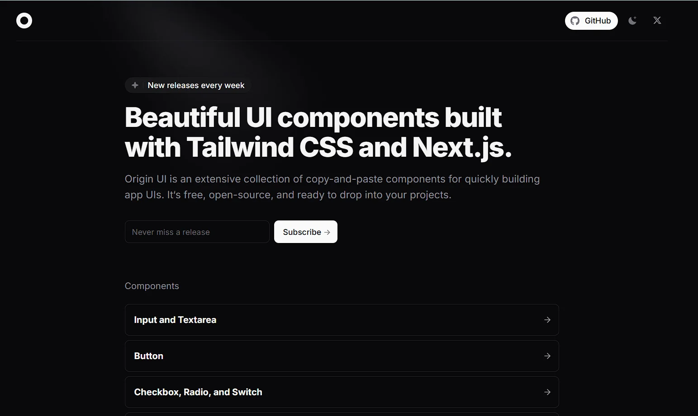

</figure>

### Shadcn/UI

Beautifully designed components built with Radix UI and Tailwind CSS. Not a traditional component library, but a collection of reusable components that can be copied and customized.

- **Highlights**: High customizability, accessible components
- **Best for**: Projects requiring full control over component implementation
- **Notable Components**: Calendar, command palette, sheets

[Link: https://ui.shadcn.com/](https://ui.shadcn.com/)

\[Image: Shadcn/UI Preview\](https://s3-alpha.figma.com/hub/file/2981095355/79132815-7823-45c4-bb41-03ad87259f09-cover.png)

### HeroUI (Previously NextUI)

Beautiful, fast, and modern React UI library built with Tailwind CSS and Framer Motion.

- **Highlights**: Modern design, dark mode support
- **Best for**: Next.js projects requiring modern UI components
- **Notable Components**: Data tables, modals, advanced form elements

[Link: https://www.heroui.com/](https://www.heroui.com/)

<figure>

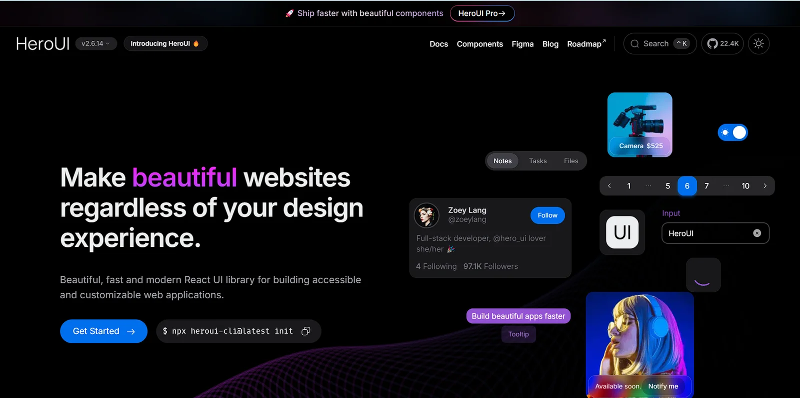

</figure>

### DevUI

Developer-focused component library with a clean, professional aesthetic.

- **Highlights**: TypeScript support, extensive documentation
- **Best for**: Enterprise applications and developer tools
- **Notable Components**: Code editors, terminal interfaces, dashboards

[Link: https://www.devui.in/](https://www.devui.in/)

<figure>

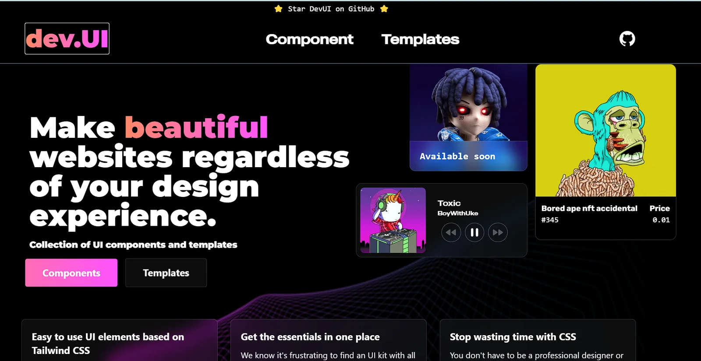

</figure>

### HyperUI

Collection of free Tailwind CSS components designed for rapid UI development.

- **Highlights**: Ready-to-use Tailwind components
- **Best for**: Quick prototyping and Tailwind CSS projects
- **Notable Components**: Marketing sections, ecommerce components

[Link: https://www.hyperui.dev/](https://www.hyperui.dev/)

<figure>

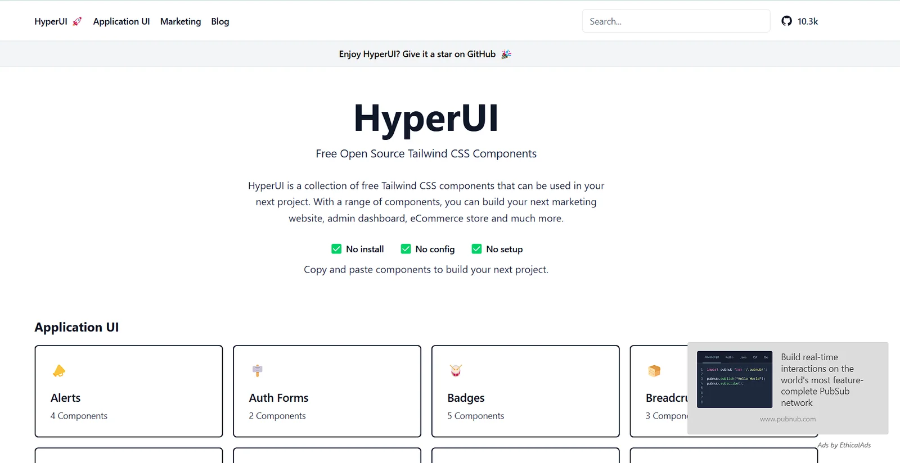

</figure>

### Magic UI

Beautifully crafted UI components with focus on animations and micro-interactions.

- **Highlights**: Unique animations, modern design patterns
- **Best for**: Applications requiring engaging user interactions
- **Notable Components**: Animated cards, loaders, transitions

[Link: https://magicui.design/](https://magicui.design/)

<figure>

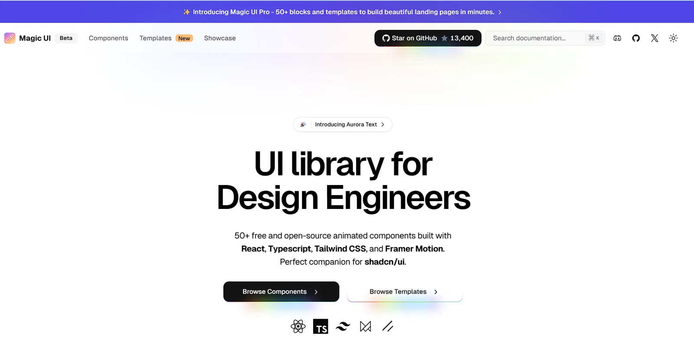

</figure>

### CuiCui

High-quality React and Tailwind CSS components library designed for easy copy-paste integration.

- **Highlights**: Instant copy-paste components, modern design
- **Best for**: Rapid development, prototyping
- **Notable Components**: Marketing sections, landing pages, interactive UI elements

[Link: https://cuicui.day/](https://cuicui.day/)

<figure>

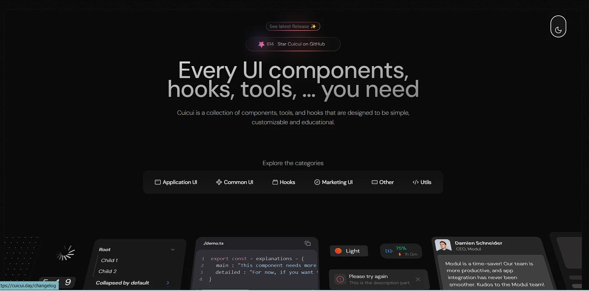

</figure>

### Ant Design

Enterprise-grade UI design system with comprehensive components.

- **Highlights**: Enterprise-ready, extensive ecosystem
- **Best for**: Large-scale enterprise applications
- **Notable Components**: Advanced tables, form builders, date pickers

[Link: https://ant.design/components/overview/](https://ant.design/components/overview/)

### Mantine

Full-featured React components library with excellent TypeScript support.

- **Highlights**: Comprehensive documentation, modular architecture
- **Best for**: TypeScript projects requiring extensive component libraries
- **Notable Components**: Rich text editor, date picker, notifications

[Link: https://mantine.dev/](https://mantine.dev/)

<figure>

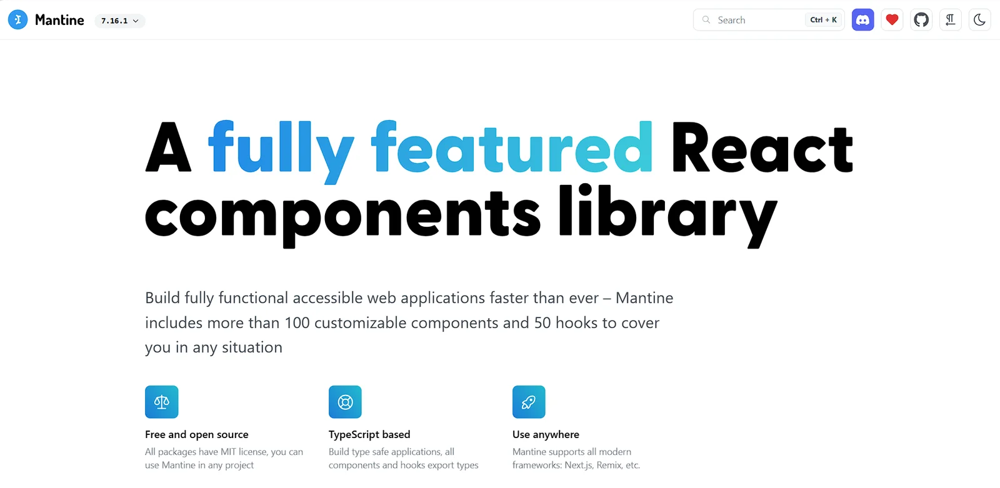

</figure>

### DotUI

Minimalist component library focused on simplicity and performance.

- **Highlights**: Lightweight, fast rendering
- **Best for**: Performance-critical applications
- **Notable Components**: Lightweight modals, tooltips, accordions

[Link: https://dotui.org/](https://dotui.org/)

<figure>

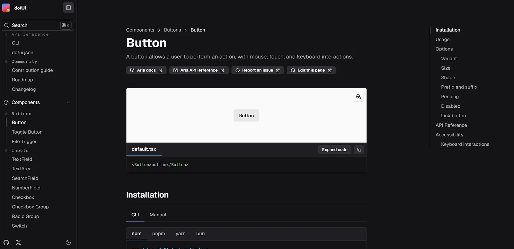

</figure>

### TailwindUI Or Tailwind Plus

Community-driven collection of Tailwind CSS components.

- **Highlights**: Ready-to-use Tailwind snippets
- **Best for**: Tailwind CSS projects needing quick solutions
- **Notable Components**: Navigation menus, cards, heroes

[Link: https://tailwindcss.com/plus](https://tailwindcss.com/plus)

<figure>

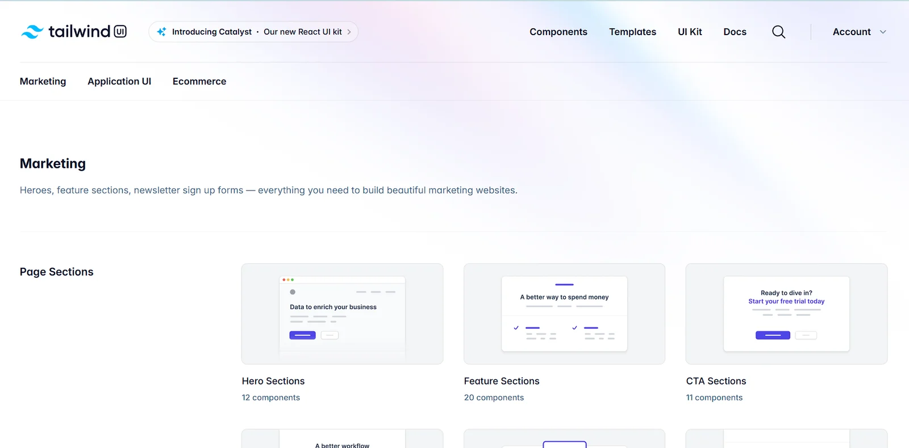

</figure>

### Tailus UI

Modern UI library built with Tailwind CSS focusing on design consistency.

- **Highlights**: Consistent design language
- **Best for**: Projects requiring cohesive design systems
- **Notable Components**: Marketing components, authentication forms

[Link: https://ui.tailus.io/](https://ui.tailus.io/)

<figure>

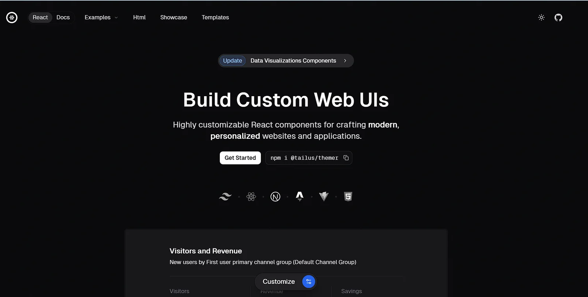

</figure>

### Mamba UI

Minimalist component library with clean, modern designs.

- **Highlights**: Clean aesthetics, minimal bundle size
- **Best for**: Projects prioritizing simplicity
- **Notable Components**: Simple yet elegant UI elements

[Link: https://mambaui.com/](https://mambaui.com/)

<figure>

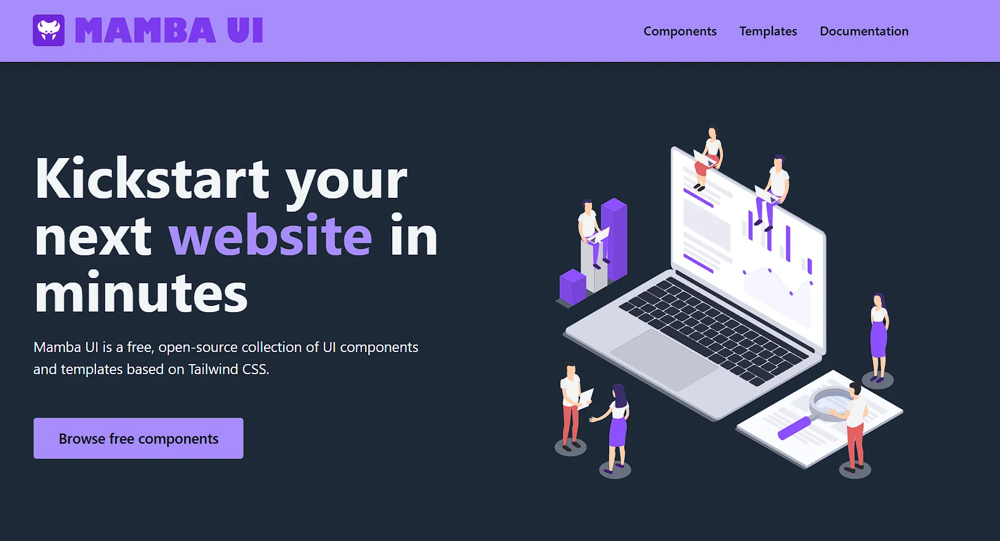

</figure>

### React Bits

Collection of interactive and animated React components.

- **Highlights**: Focus on interactive elements
- **Best for**: Projects needing engaging UI interactions
- **Notable Components**: Bounce cards, animated interfaces

[Link: https://www.reactbits.dev/](https://www.reactbits.dev/)

<figure>

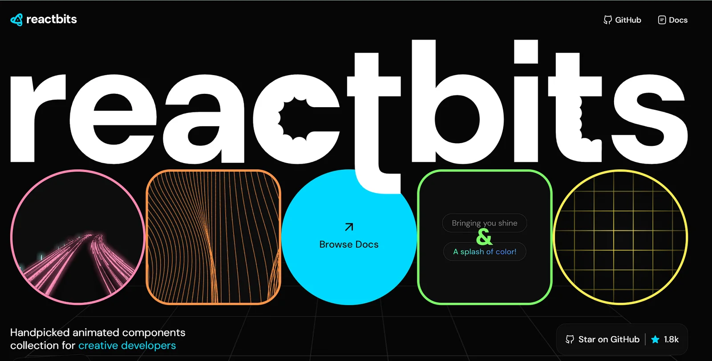

</figure>

## Getting Started

1. Choose a library based on your project needs:
   - Consider factors like bundle size, customization options, and documentation quality
   - Check compatibility with your tech stack
   - Review the component ecosystem
1. Installation typically follows one of these patterns:

```bash
# For npm
npm install @library-name/react

# For yarn
yarn add @library-name/react
```

1. Most libraries support tree-shaking for optimal bundle sizes

## Best Practices

- **Mix and Match**: Don't hesitate to use components from different libraries when needed
- **Customize**: Most libraries support theming and styling customization
- **Accessibility**: Verify accessibility features of components before implementation
- **Performance**: Monitor bundle size impact when adding new components

*Last updated: January 2025*
