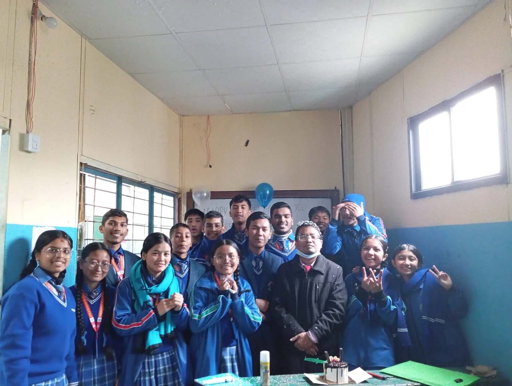
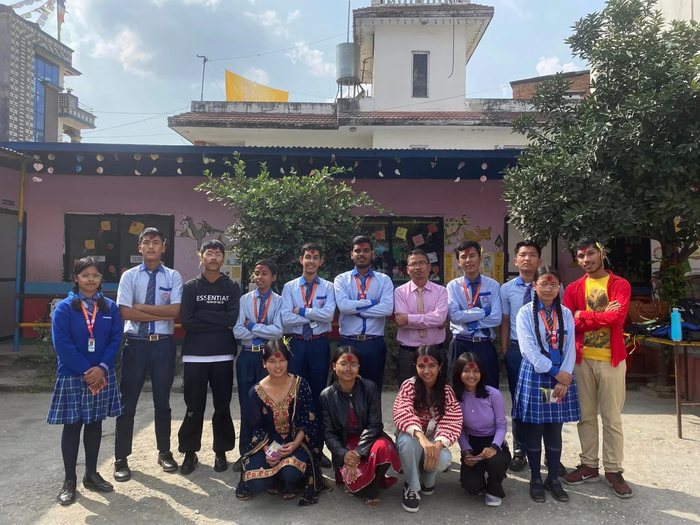
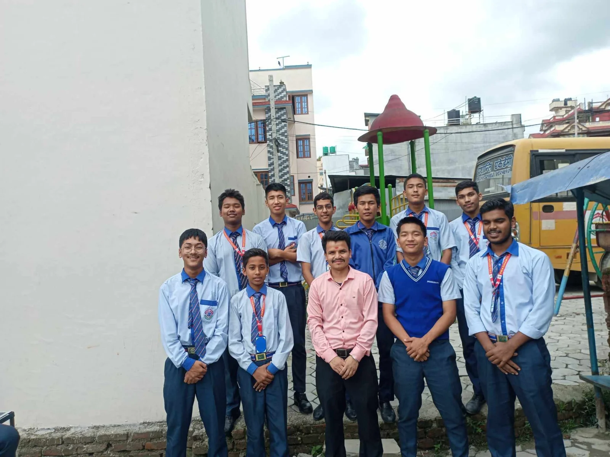
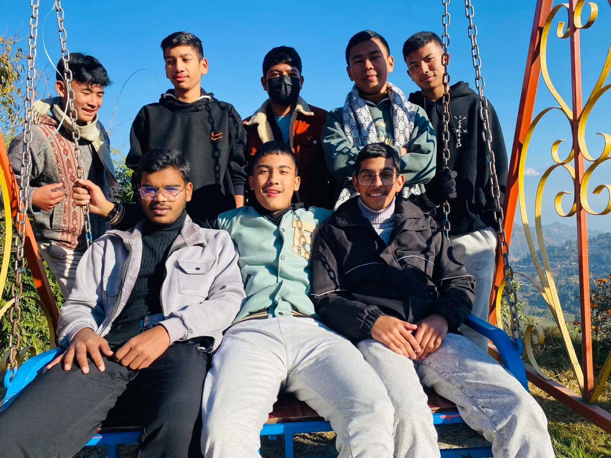
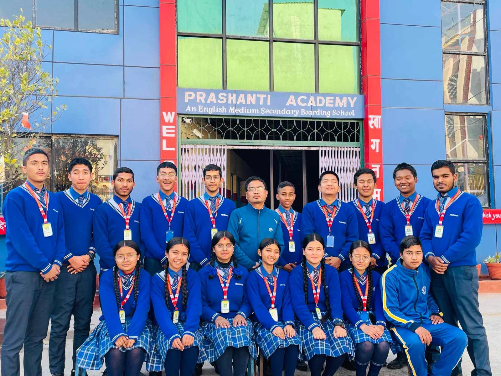
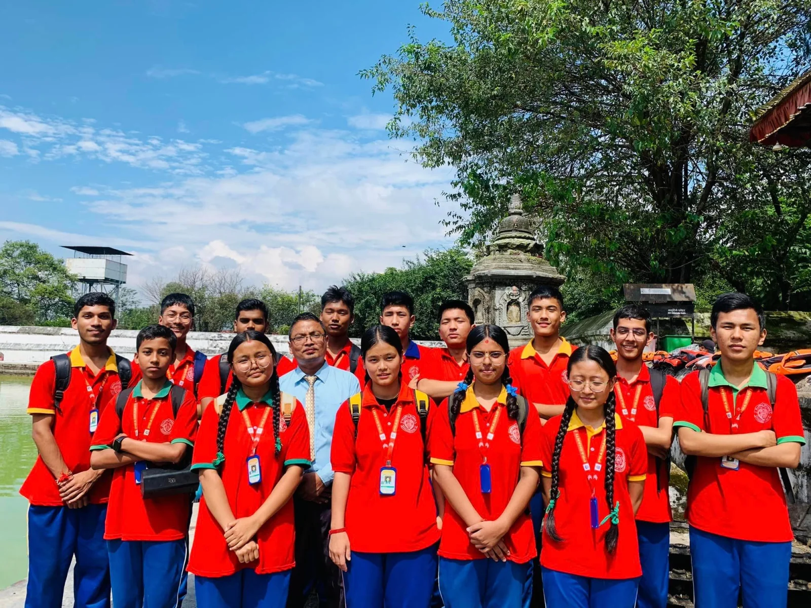
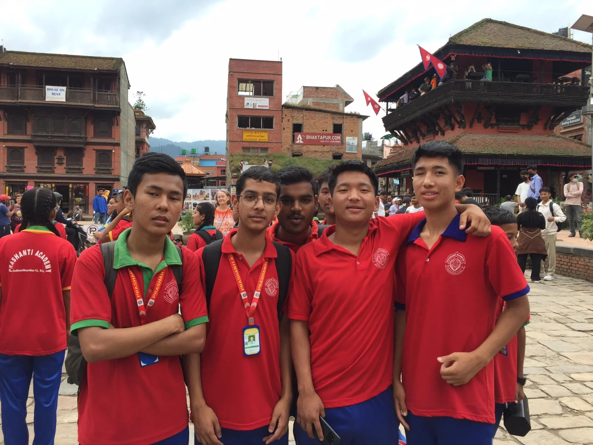
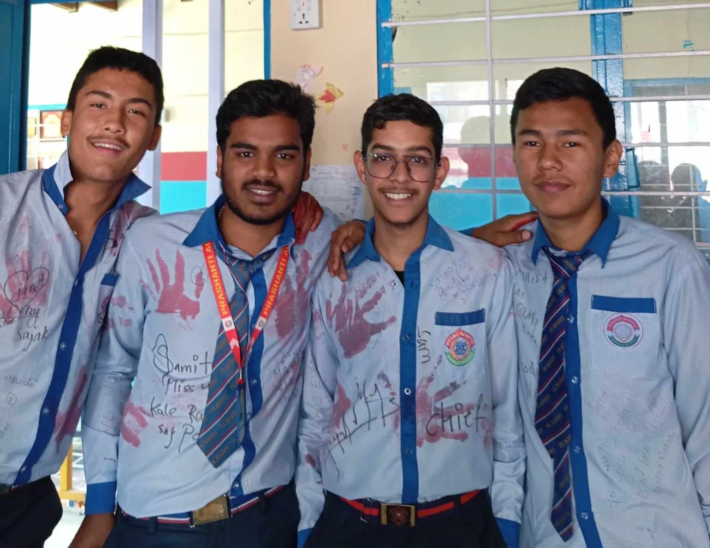
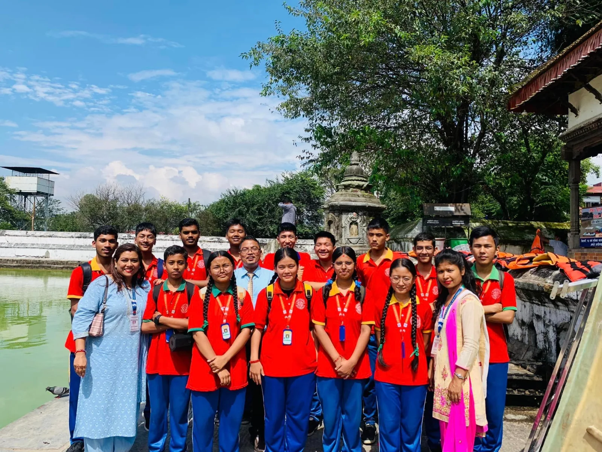
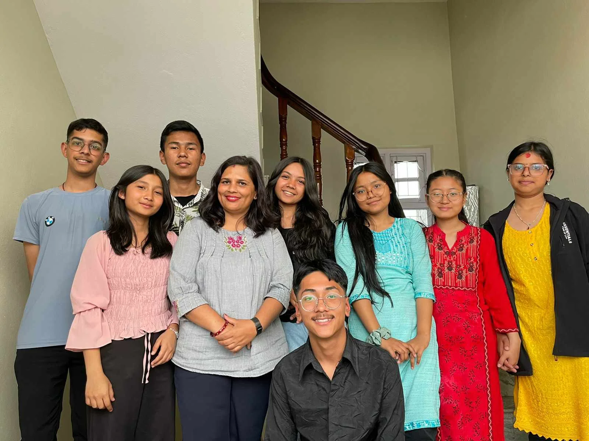

### My Personal Journey with Prashanti Academy: A Tale of Growth and Gratitude

During the coronavirus pandemic in 2020, Prashanti Academy became my place of comfort and direction. Transitioning to online classes was challenging, but the supportive school management and teachers made it easier. Preparing for my Grade 10 SEE exam in April 2024, I realize how much the past four years have shaped me. Despite the disruptions caused by lockdowns, Prashanti Academy's constant support helped me stay on track, teaching me values like honesty, patience, and competitiveness. Each day brought new knowledge and creative activities, fostering not only academic growth but also essential life skills.

The dedicated educators—Principal **Mr. Samir Bastola**, English teacher **Mr. Hari Shrestha**, Nepali teachers **Ms. Geeta Sharma** and **Ms. Hiru Shrestha**, Social teacher **Ms. Goma Adhikari** and **Ms. Punam Bhandari**, Computer teacher **Mr. Milan Kumar Sunuwar**, Science teacher **Mr. Aadarsh Poudel**, and Math teachers **Mr. Sagar Sharma** and **Mr. Rohit Ghimire**—have made a lasting impact on me. **Mrs. Dhanu Hamal**, my first guide at Prashanti Academy, holds a special place in my heart for her mentorship, which fills me with pride and gratitude.

I have fond memories of the school—the excitement of food festivals, annual programs, Friday extracurricular activities, and Sports Week. I remember myself in the computer lab, writing QBasic and C programs, and the honor of being Aadarsh Sir's lab assistant. These moments are dear to me, making me wish I could relive those years filled with learning, laughter, and love. Prashanti Academy will always be special to me, a place where I grew and learned, showing the true power of education.

<figure>

<figcaption>On Hari Sir Birthday 🥳</figcaption>

</figure>

<figure>

<figcaption>Group photo of Dashain Celebration 2080</figcaption>

</figure>

<figure>

<figcaption>Group photo with Mukesh Tammata Sir.</figcaption>

</figure>

<figure>

<figcaption>Lakpa, Rajip, Aaditya, me, Gyaba, Sajak, Prajwol and Abhishek during picnic 2080, Nagarkot</figcaption>

</figure>

<figure>

</figure>

<figure>

</figure>

<figure>

</figure>

<figure>

<figcaption>Last day of school after SEE examination.</figcaption>

</figure>

<figure>

</figure>

<figure>

</figure>
