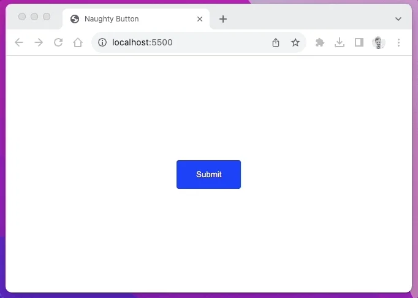

<figure>



</figure>

\
Here's the most viral naughty button source code:

```html
<!DOCTYPE html>
<html lang="en">
  <head>
    <meta charset="UTF-8" />
    <meta name="viewport" content="width=device-width, initial-scale=1.0" />
    <title>Naughty Button</title>
    <style>
      html,
      body {
        width: 100%;
        height: 100%;
        display: flex;
        justify-content: center;
        align-items: center;
      }
      button {
        background-color: blue;
        border: none;
        color: #fff;
        padding: 1rem 2rem;
        border-radius: 4px;
        transform-style: preserve-3d;
      }
      .button-wrapper {
        perspective: 400px;
      }
    </style>
  </head>
  <body>
    <div class="button-wrapper">
      <button id="button">Submit</button>
    </div>
    <script>
      const button = document.getElementById('button')
      const distanceBetween = (p1x, p1y, p2x, p2y) => {
        const dx = p1x - p2x
        const dy = p1y - p2y
        return Math.sqrt(dx * dx + dy * dy)
      }
      const bx =
        button.parentNode.offsetLeft +
        button.offsetLeft +
        button.offsetWidth / 2
      const by =
        button.parentNode.offsetTop + button.offsetTop + button.offsetHeight / 2
      const radius = Math.max(
        button.offsetWidth * 0.75,
        button.offsetHeight * 0.75,
        100,
      )
      document.addEventListener('mousemove', (event) => {
        const dist = distanceBetween(event.clientX, event.clientY, bx, by)
        const angle = Math.atan2(event.clientY - by, event.clientX - bx)
        const ox = -1 * Math.cos(angle) * Math.max(radius - dist, 0)
        const oy = -1 * Math.sin(angle) * Math.max(radius - dist, 0)
        const rx = oy / 2
        const ry = -ox / 2
        button.style.transition = 'all 0.1s ease'
        button.style.transform = `translate(${ox}px, ${oy}px) rotateX(${rx}deg) rotateY(${ry}deg)`
        button.style.boxShadow = `0px ${Math.abs(oy)}px ${
          (Math.abs(oy) / radius) * 40
        }px rgba(0,0,0,.15)`
      })
    </script>
  </body>
</html>
```
