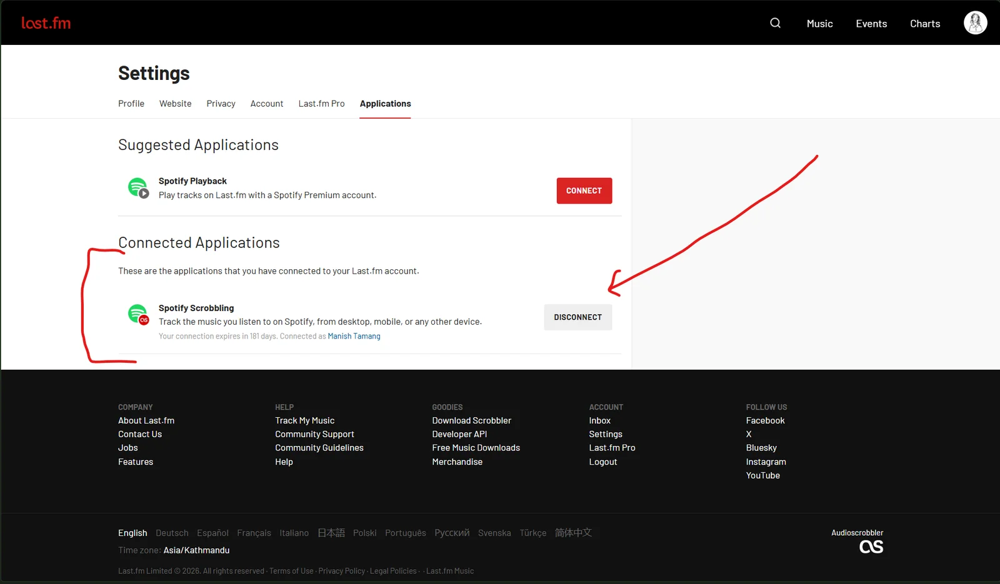
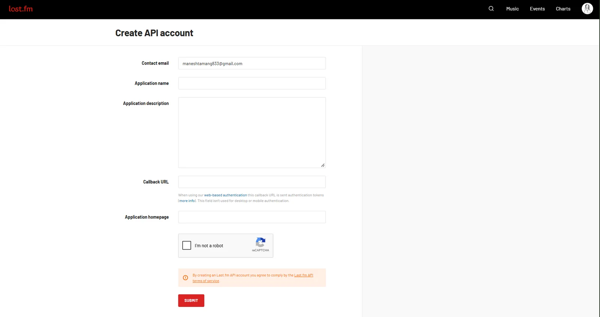

A while ago I wrote about [using the Spotify API with Next.js](https://manishtamang.com/blog/spotify-api-with-next-js-to-fetch-user-s-top-track). Since February 2026, Spotify only lets developer apps work if the owner has **Spotify Premium**. I didn't want to pay just to show a song on my site, so I switched to Last.fm.

It's actually simpler: no OAuth, no refresh tokens. Just one API key and one request.

## Connect Spotify to Last.fm

Last.fm records ("scrobbles") every song you play. Free Spotify accounts can connect to it.

- Create a free account on [Last.fm](https://www.last.fm/join).
- Go to [Settings → Applications](https://www.last.fm/settings/applications) and click **Connect** next to Spotify.
- Play a song and open your Last.fm profile. You should see it under "Scrobbling now".

<figure>



</figure>

## Get an API Key

- Go to [Create API account](https://www.last.fm/api/account/create).
- Give it any name. You can leave the callback URL empty.
- Copy the **API key**. You don't need the shared secret.

<figure>



</figure>

Add it to your `.env.local` with your Last.fm username.

```bash
LASTFM_API_KEY=your_api_key
LASTFM_USERNAME=your_username
```

## Fetch the Current Song

Create `lib/lastfm.ts`. We ask Last.fm for your latest track. If it's playing right now, it has `@attr.nowplaying` set to `"true"`.

```ts
const API_KEY = process.env.LASTFM_API_KEY
const USERNAME = process.env.LASTFM_USERNAME

export async function getNowPlaying() {
  const url = `https://ws.audioscrobbler.com/2.0/?method=user.getrecenttracks&user=${USERNAME}&api_key=${API_KEY}&format=json&limit=1`
  const res = await fetch(url, { cache: "no-store" })
  const data = await res.json()
  const track = data.recenttracks?.track?.[0]

  if (!track) return { isPlaying: false }

  return {
    isPlaying: track["@attr"]?.nowplaying === "true",
    title: track.name,
    artist: track.artist["#text"],
    album: track.album["#text"],
    albumImageUrl: track.image.at(-1)?.["#text"],
    songUrl: track.url,
  }
}
```

### Creating an API Route

Create `app/api/now-playing/route.ts`. The cache header means Vercel only asks Last.fm once every 30 seconds, no matter how many people visit.

```ts
import { getNowPlaying } from "@/lib/lastfm"

export async function GET() {
  const song = await getNowPlaying()

  return Response.json(song, {
    headers: { "cache-control": "public, s-maxage=30, stale-while-revalidate=30" },
  })
}
```

Run `next dev`, play a song, and open `localhost:3000/api/now-playing`. You can also see mine live at [manishtamang.com/api/now-playing](https://manishtamang.com/api/now-playing).

```json
{
  "isPlaying": true,
  "title": "Rangharu (feat. Aastha Tamang Maskey)",
  "artist": "Topi",
  "album": "Mitho Bihani",
  "albumImageUrl": "https://lastfm-img.freetls.fastly.net/i/u/300x300/5bf8ee5ad5ea43d2c3e32f1e2f9a6030.jpg",
  "songUrl": "https://www.last.fm/music/Topi/_/Rangharu+(feat.+Aastha+Tamang+Maskey)"
}
```

## Show It on Your Site

A small client component that checks for a new song every 30 seconds.

```tsx
"use client"

import { useEffect, useState } from "react"

type Song = {
  isPlaying: boolean
  title?: string
  artist?: string
  albumImageUrl?: string
  songUrl?: string
}

export function NowPlaying() {
  const [song, setSong] = useState<Song | null>(null)

  useEffect(() => {
    const load = () => fetch("/api/now-playing").then((res) => res.json()).then(setSong)
    load()
    const timer = setInterval(load, 30_000)
    return () => clearInterval(timer)
  }, [])

  if (!song?.title) return null

  return (
    <a href={song.songUrl} target="_blank" rel="noopener noreferrer" className="flex items-center gap-3">
      {song.albumImageUrl && (
        
      )}
      <div>
        <p className="text-xs text-green-600">{song.isPlaying ? "Now Playing" : "Last Played"}</p>
        <p className="font-medium">{song.title}</p>
        <p className="text-sm text-zinc-500">{song.artist}</p>
      </div>
    </a>
  )
}
```

## Bonus: Missing Album Covers

Last.fm doesn't have covers for many smaller releases and returns a grey star instead. Apple's iTunes search is free, needs no key, and usually has them.

```ts
async function getCover(title: string, artist: string) {
  const term = encodeURIComponent(`${artist} ${title}`)
  const res = await fetch(`https://itunes.apple.com/search?term=${term}&entity=song&limit=1`)
  const { results } = await res.json()
  return results[0]?.artworkUrl100?.replace("100x100bb", "600x600bb")
}
```

Use it when Last.fm's image URL contains `2a96cbd8b46e442fc41c2b86b821562f` (that's the grey star placeholder).

That's it. No Premium, no tokens, and it works for whatever you play on your phone too.\
Happy Coding ❤️
