## 16 Developer Portfolios That Will Make You Rethink Your Personal Brand

Building a developer portfolio in 2025 isn't just about showcasing code. It's about telling your story, demonstrating your problem-solving approach, and creating an experience that potential employers or clients won't forget. After spending countless hours browsing through developer portfolios, I've found 16 that truly stand out from the crowd.

## 1\. [Ouassim](https://ouassim.tech/): When Less Really Is More

Ouassim's portfolio proves that you don't need flashy animations or bold colors to make an impact. His clean, typography-focused design creates a sophisticated experience that puts the spotlight exactly where it should be: on his work. The monochromatic color scheme feels intentional rather than boring, and the subtle animations add just enough movement to keep things interesting.

What makes it work:

- Navigation that feels effortless
- Case studies that actually tell a story
- Looks great whether you're on desktop or mobile

<figure>

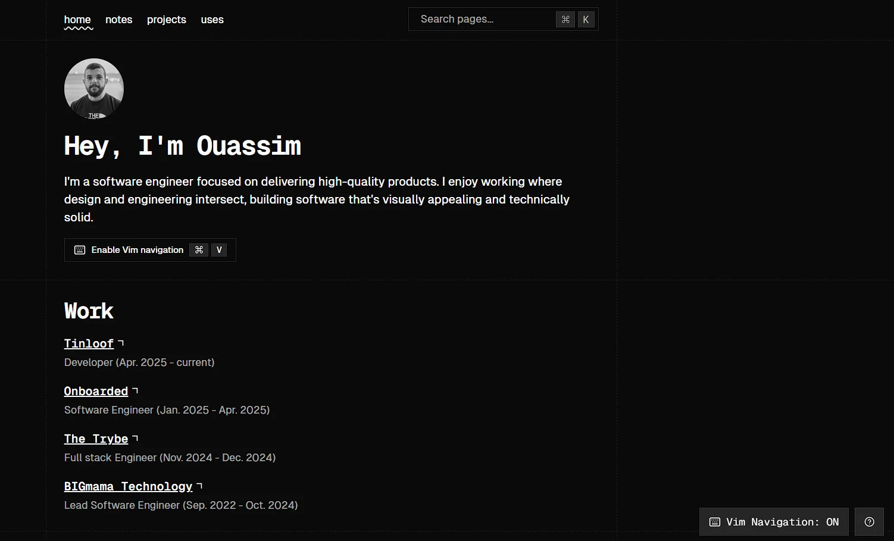

</figure>

## 2\. [Jahir Fiquitiva](https://jahir.dev/): Material Design Done Right

If you've ever wondered what happens when someone truly masters Material Design, look no further than Jahir's portfolio. The vibrant colors and smooth transitions don't just look good. They create an experience that feels intuitive and polished. You can tell he genuinely cares about user experience.

What caught my attention:

- Projects you can actually interact with
- Clear breakdown of what technologies he used
- Dark/light mode toggle that doesn't feel like an afterthought

<figure>

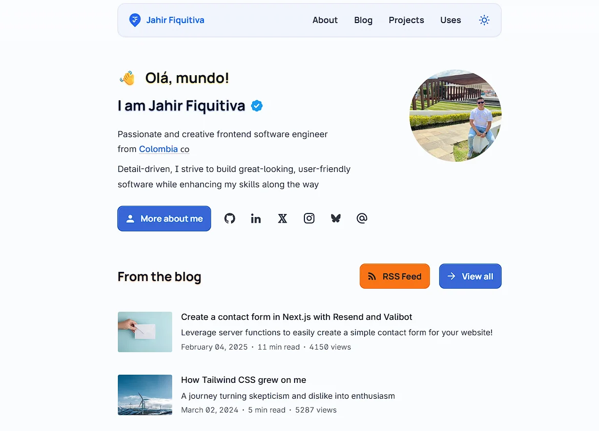

</figure>

## 3\. [Theodorus Clarence](https://theodorusclarence.com/): Your Professional Journey as a Story

Theodorus has created something special here. Instead of the typical "here are my projects" approach, his portfolio feels like reading through someone's professional evolution. The way he integrates his personal story with his technical achievements creates a connection that most portfolios miss entirely.

Why it works:

- Animations that enhance rather than distract
- Personal narrative woven throughout
- Project presentations that feel fresh and engaging

<figure>

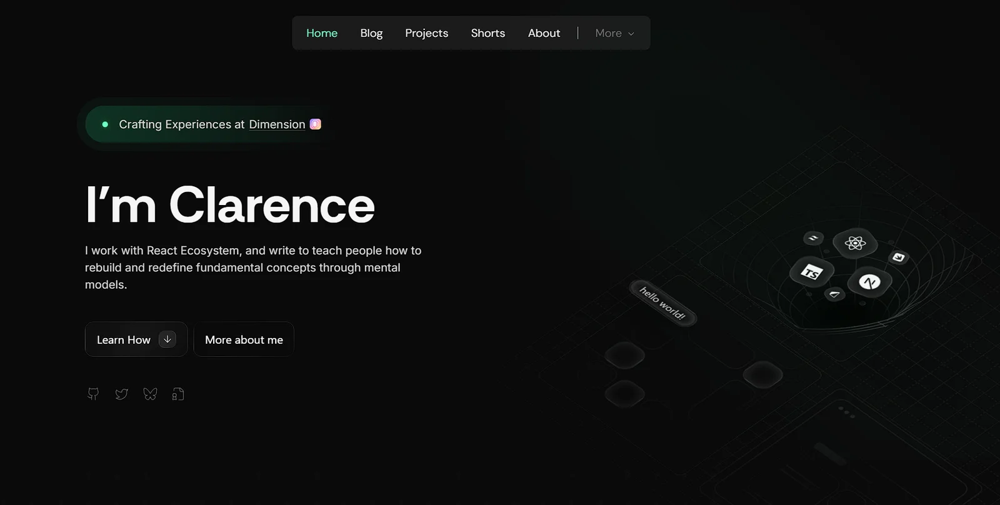

</figure>

## 4\. [Bona Brian Siagian](https://bonabrian.com/): A Visual Feast

Bona's portfolio is what happens when exceptional design skills meet solid development chops. Every project presentation feels like a mini-experience, complete with 3D previews and multimedia case studies. It's ambitious without being overwhelming.

Standout elements:

- 3D project previews that actually add value
- Rich multimedia storytelling
- Seamless blend of design and development work

<figure>

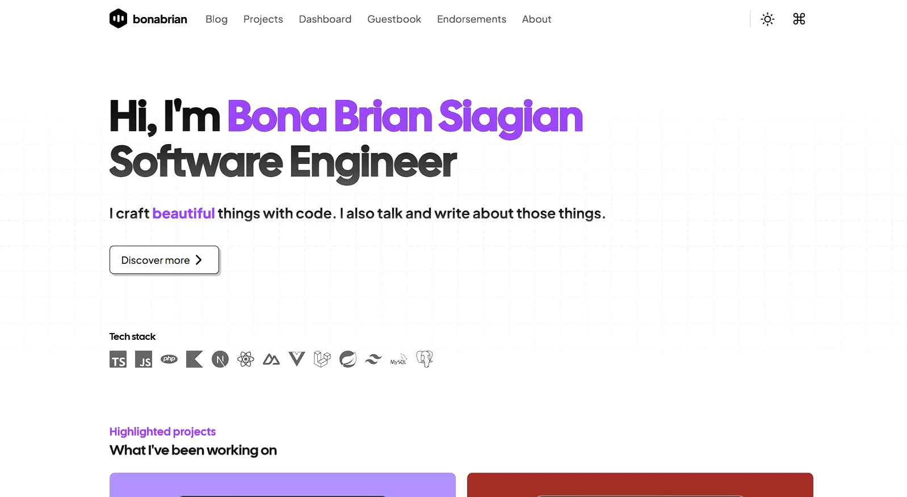

</figure>

## 5\. [Lee Robinson](https://leerob.com/): Impact Over Everything

Lee's portfolio reflects his journey from engineer to executive at Vercel, and it's refreshingly honest about what actually matters in tech careers. Instead of trying to impress with flashy designs, he focuses on the impact he's had. For example, helping grow Next.js to over 1.3 million developers.

What sets it apart:

- Clean design that prioritizes content
- Focus on measurable impact and achievements
- Personal touches that don't feel forced
- Emphasis on shipping quickly and effectively

<figure>

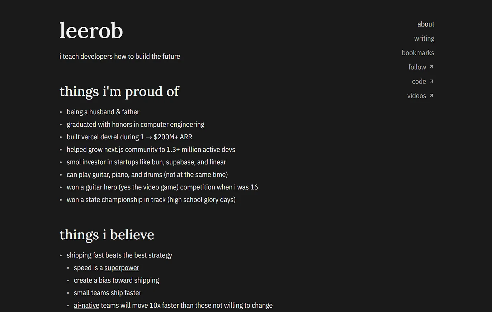

</figure>

## 6\. [Marc Bouchenoire](https://marcbouchenoire.com/): Simplicity That Works

Marc's approach is refreshingly straightforward. His portfolio doesn't try to reinvent the wheel. It just executes the basics exceptionally well. Sometimes that's exactly what you need.

Strengths:

- Interface that gets out of your way
- Project descriptions that are actually useful
- Fast loading times (seriously, try it)

<figure>

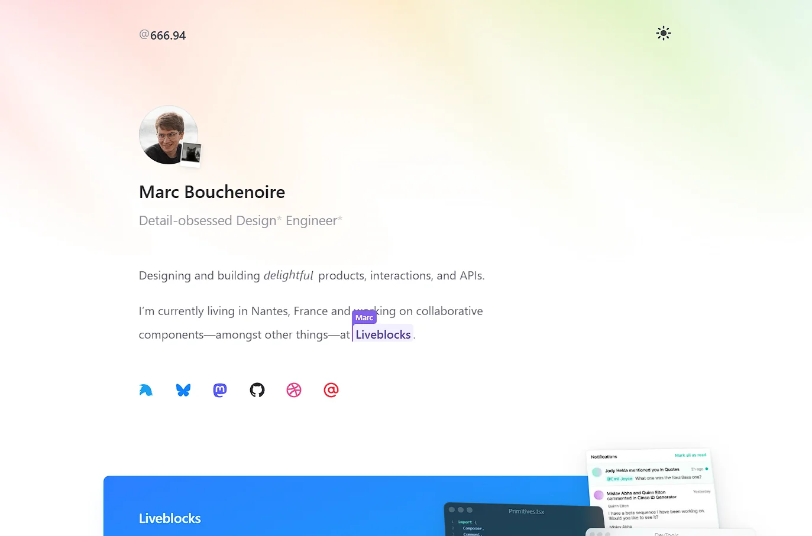

</figure>

## 7\. [Victor Eke](https://victoreke.com/): Breaking the Rules

Victor's portfolio feels like a playground, but in the best possible way. The creative interactions and playful elements demonstrate his technical skills while showing his personality. It's bold without being unprofessional.

Creative touches:

- Navigation that surprises without confusing
- Project presentations with personality
- Consistent branding throughout

<figure>

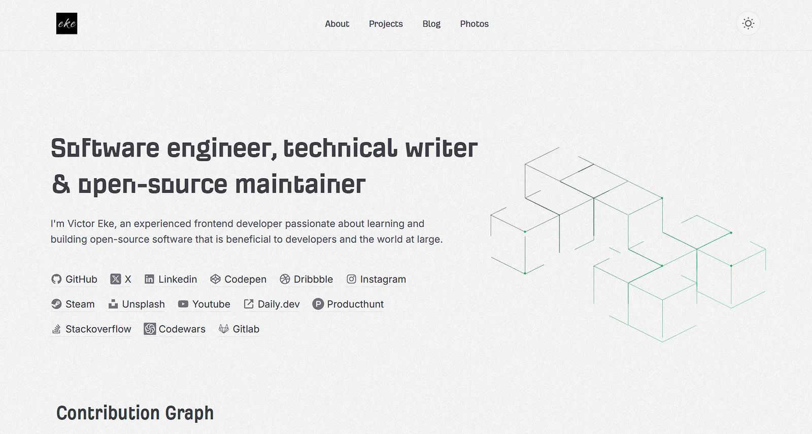

</figure>

## 8\. [Ryan Aulia](https://aulianza.id/): Modern Without Being Trendy

Ryan has managed to create something that feels contemporary without chasing every design trend. The smooth scrolling effects and modern typography create an experience that feels polished and professional.

Design highlights:

- Scrolling that enhances the experience
- Typography choices that actually improve readability
- Skills section that doesn't feel like a resume

<figure>

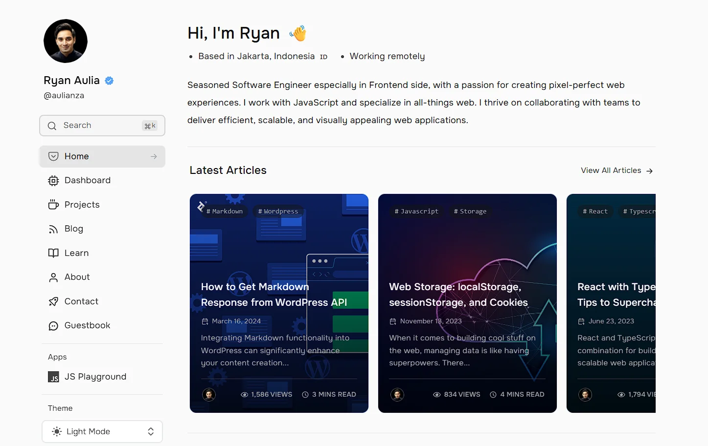

</figure>

## 9\. [Vijay Verma](https://vjy.me/): When Design Meets Development

Vijay's portfolio successfully bridges the gap between design and development. Each project feels carefully crafted, with detailed process documentation that shows how he thinks through problems.

What makes it special:

- Projects that showcase both design and code
- Process documentation that's actually interesting
- Interactions that feel natural

<figure>

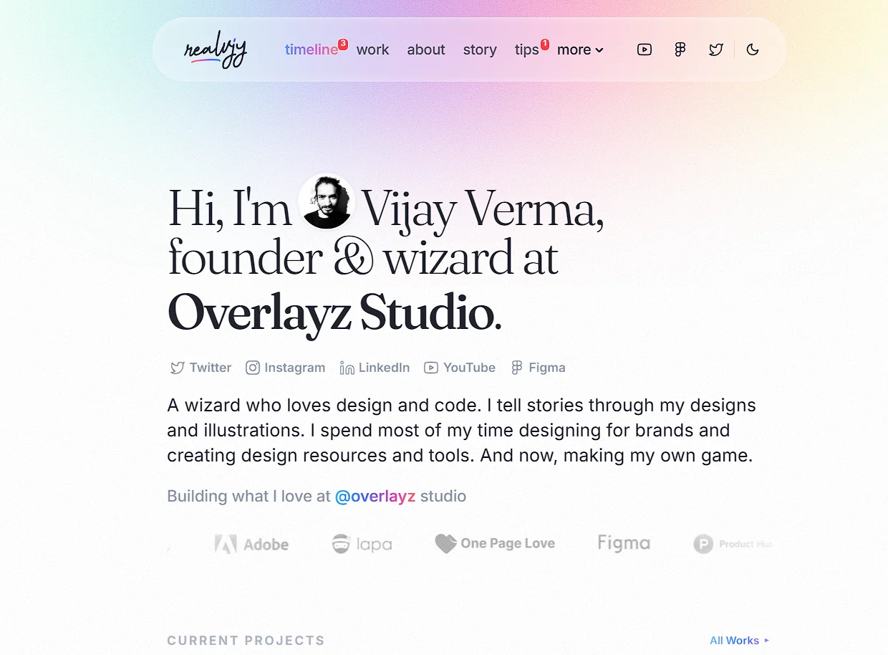

</figure>

## 10\. [Raphaël Chelly](https://www.raphaelchelly.com/): Technical Depth

Raphaël's portfolio goes deeper than most. The technical explanations and personal insights create a picture of someone who doesn't just code, but thinks deeply about the craft of software development.

Unique approach:

- Technical breakdowns that teach you something
- Personal growth story that feels genuine
- Blog integration that adds real value

<figure>

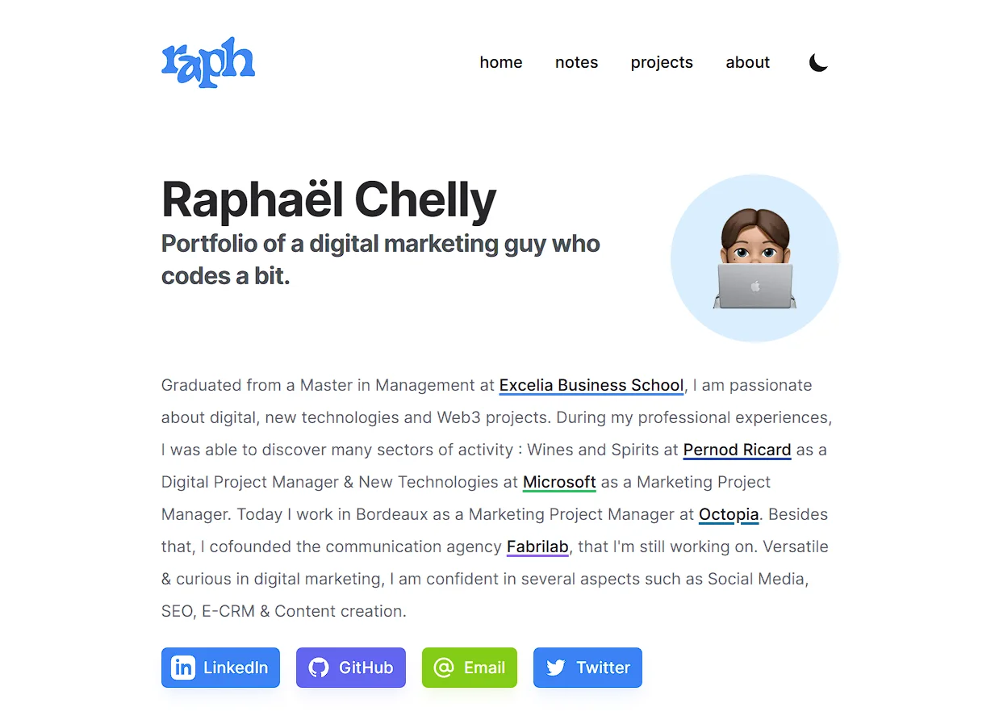

</figure>

## 11\. [Daniel Wirtz](https://danielwirtz.com/): More App Than Website

Daniel's portfolio challenges what a portfolio website can be. It feels more like interacting with an application than browsing a static site, which perfectly demonstrates his skills as a developer.

Innovation highlights:

- Interactive demonstrations that work
- Technical explanations that aren't boring
- User interactions that feel purposeful

<figure>

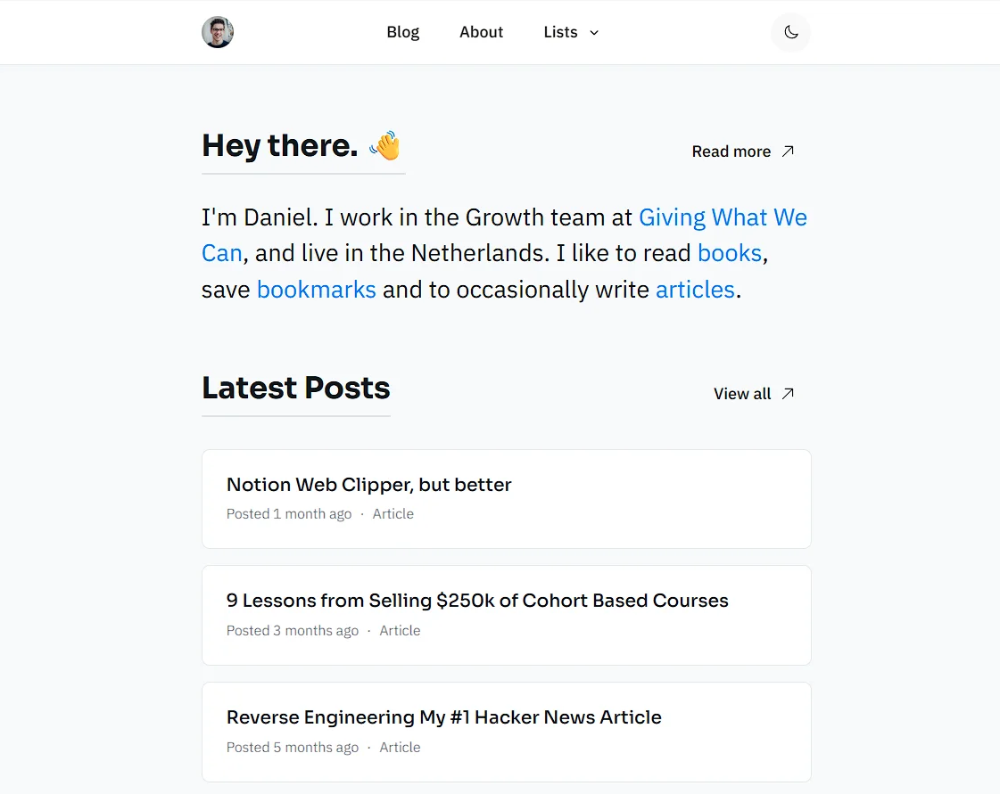

</figure>

## 12\. [David Darnes](https://darn.es/): Attention to Detail

David's portfolio shows what happens when someone sweats the small stuff. Every element feels intentional and carefully considered, creating an overall experience that feels polished and professional.

Design philosophy:

- Details that most people would miss
- Layout that guides your attention naturally
- Project documentation that's actually comprehensive

<figure>

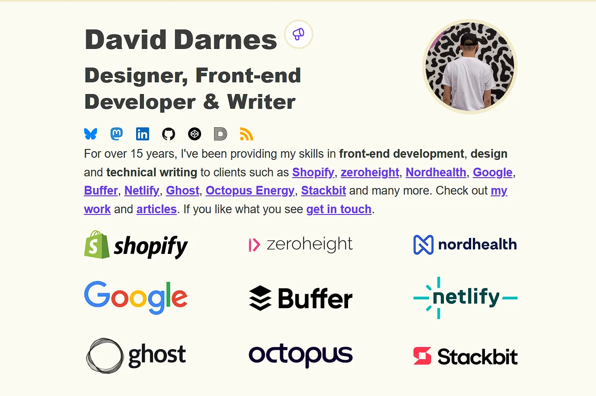

</figure>

## 13\. [Håvard Brynjulfsen](https://www.havardbrynjulfsen.design/): Scandinavian Simplicity

Håvard's portfolio embodies everything good about Scandinavian design: it's clean, functional, and beautiful without being showy. The minimalist approach creates focus rather than emptiness.

Why it works:

- Layout that doesn't waste your time
- Navigation that makes sense immediately
- Project presentations that get to the point

<figure>

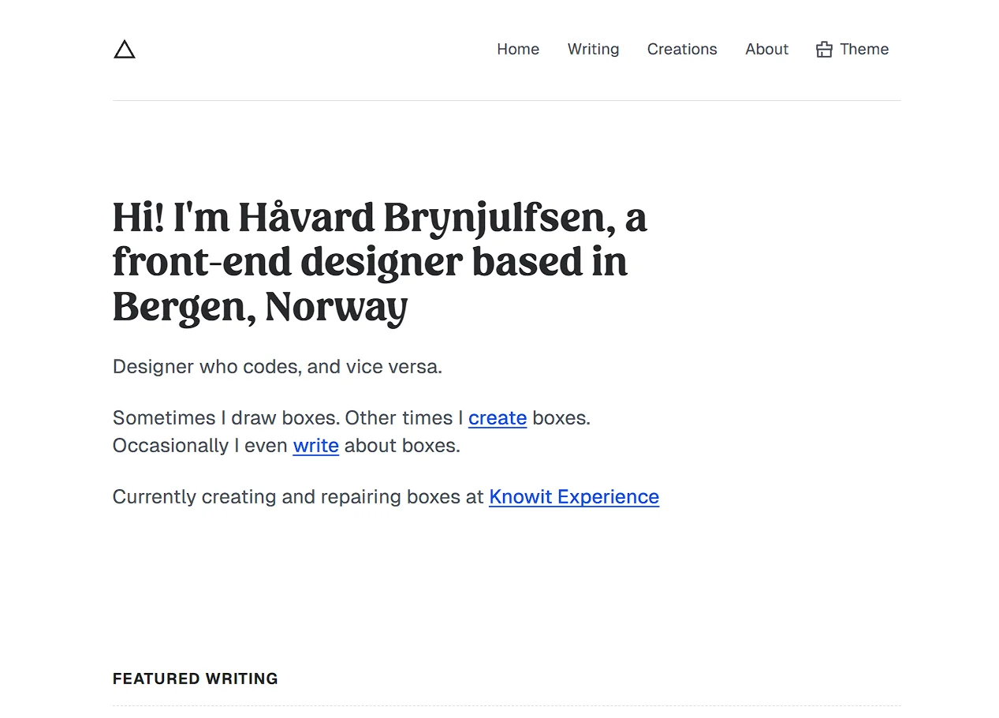

</figure>

## 14\. [Alexander Vilinskyy](https://www.vilinskyy.com/): Visual Storytelling

Alexander uses compelling graphics and smooth interactions to create a visual journey through his professional experience. It's the kind of portfolio that makes you want to scroll through the entire thing.

Standout features:

- Visuals that actually communicate something
- Smooth scrolling that enhances the story
- Personal branding that feels authentic

<figure>

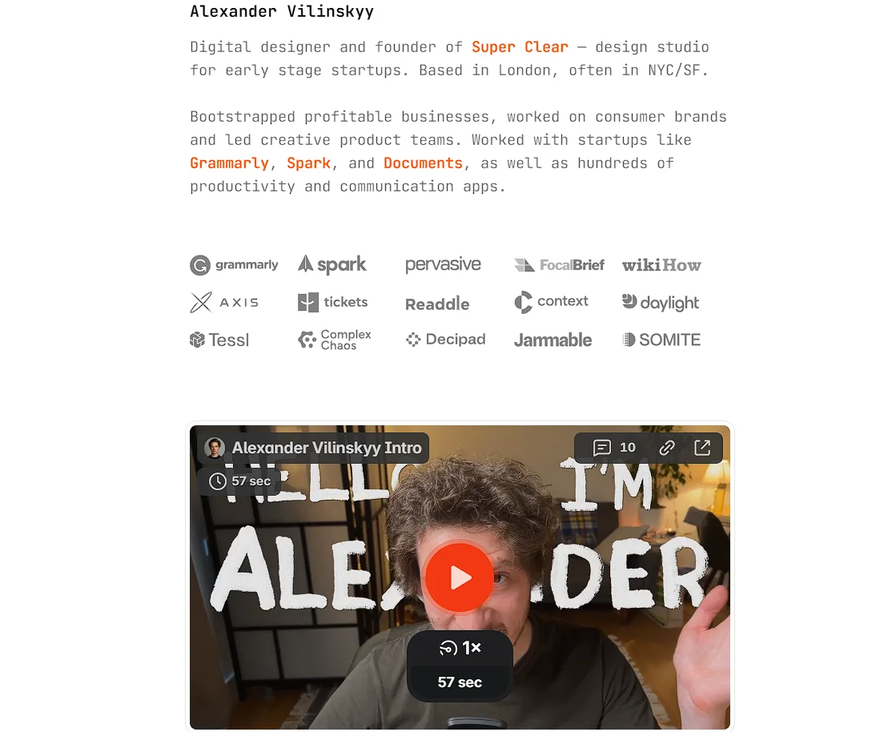

</figure>

## 15\. [Chánh Đại](https://chanhdai.com/): The Complete Package

Chánh's portfolio brilliantly showcases his dual skills as both a Software Developer and UI/UX Designer. It's comprehensive without being overwhelming, which is harder to achieve than it sounds.

What works:

- Clear presentation of diverse skills
- Case studies that show his process
- Professional storytelling that doesn't feel corporate

<figure>

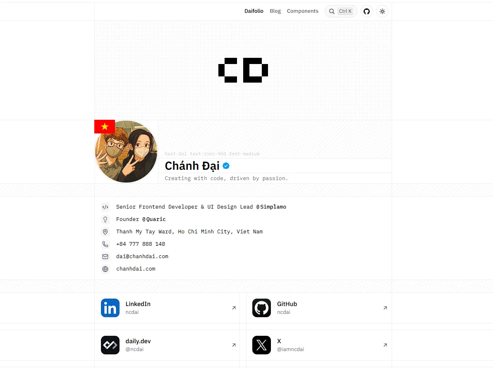

</figure>

## 16\. [Josh W. Comeau](https://joshwcomeau.com/): Teaching Through Showcasing

Josh's portfolio goes beyond showcasing. It's an interactive learning experience. The detailed explanations and engaging demonstrations reflect his commitment to education and technical excellence.

Remarkable features:

- Code demonstrations you can actually interact with
- Tutorials that make complex concepts accessible
- Personal narrative that draws you in

<figure>

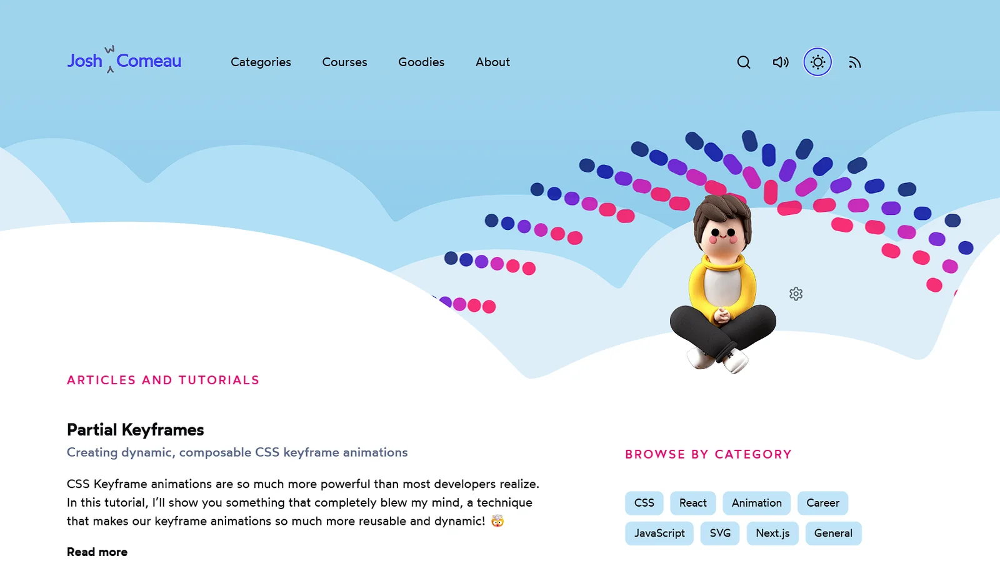

</figure>

## Conclusion

These portfolios represent something more than just good design or clean code. They show developers who understand that a portfolio is really about communication. It's about communicating your skills, your personality, and your approach to solving problems.

The best portfolios from this list share a few common elements: they tell a story, they show personality, and they demonstrate both technical and design thinking. Most importantly, they create an experience that makes you want to learn more about the person behind the work.

Your portfolio is often the first impression you make on potential employers or clients. Make it count by focusing on what makes you unique, not what you think everyone else wants to see.

*Note: The web is constantly evolving, and what impresses today might be standard tomorrow. The key is to keep experimenting and finding new ways to tell your story.*
