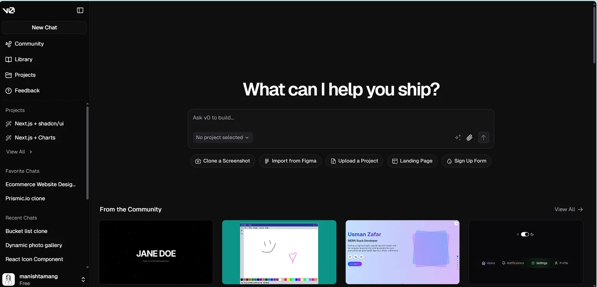
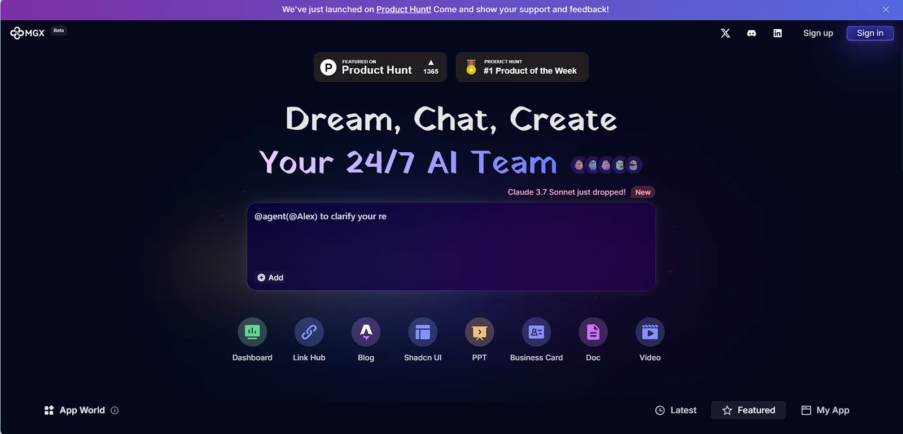
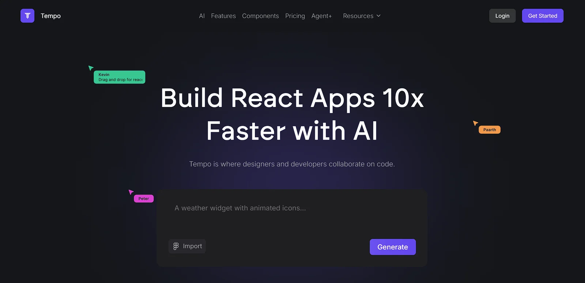
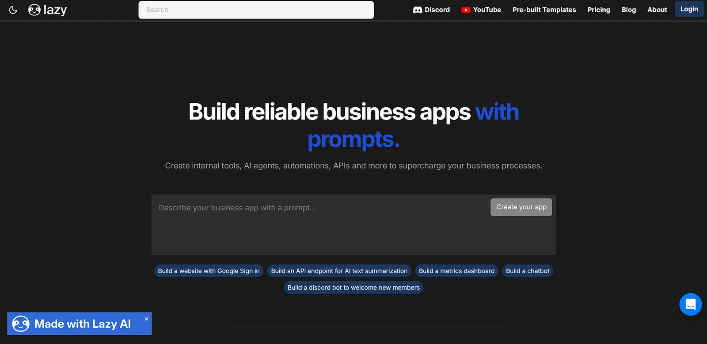
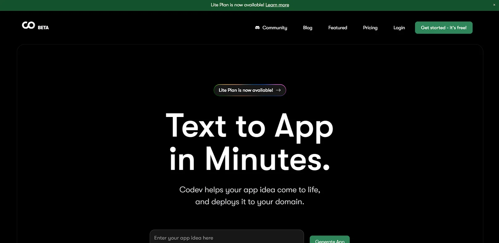
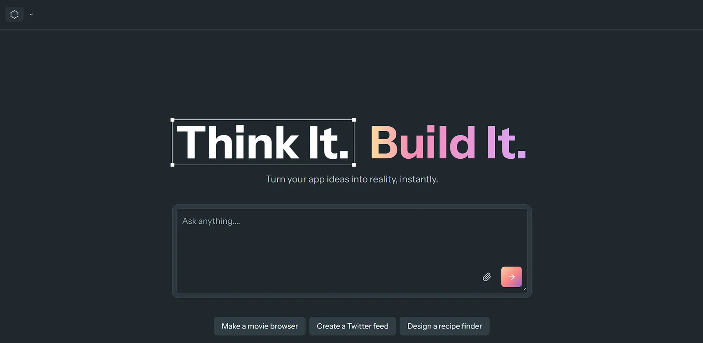
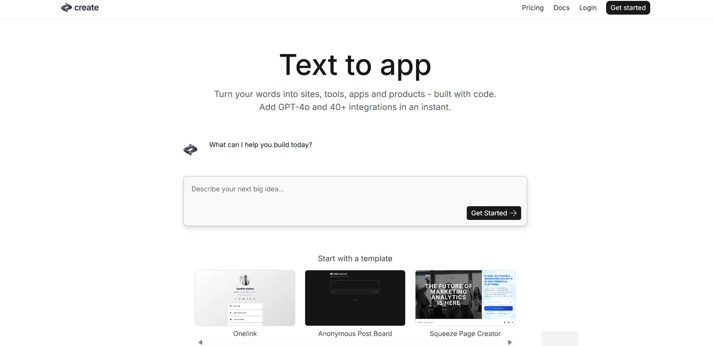
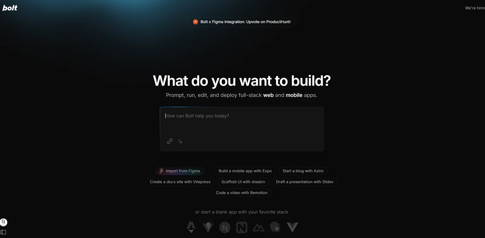
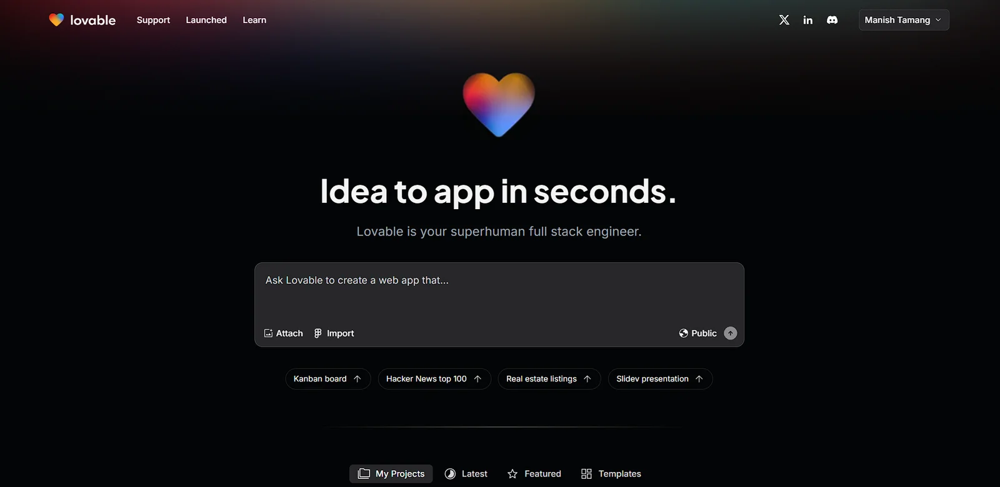

In the rapidly evolving world of web development, AI-powered tools are transforming how developers create, design, and deploy full-stack web applications. Gone are the days of tedious, time-consuming coding processes. Today, we'll explore the top 10 AI tools that are changing the game for developers and entrepreneurs alike.

## 1\. v0.dev: The AI Design Powerhouse

v0.dev stands out as a game-changing platform that generates React components and entire user interfaces with unprecedented ease. Powered by cutting-edge AI, this tool allows developers to transform text prompts into fully functional UI designs, dramatically reducing development time and effort.

Key Features:

- AI-generated React components
- Instant UI prototyping
- Seamless integration with modern web frameworks

<figure>

</figure>

## 2\. MGX.dev: Full-Stack Magic

MGX.dev offers a comprehensive solution for full-stack development, leveraging AI to streamline both frontend and backend processes. Its intelligent code generation capabilities can transform project concepts into functional applications in record time.

Highlights:

- Full-stack code generation
- Automatic backend logic creation
- Smart architecture recommendations

<figure>

</figure>

## 3\. Tempo.new: Rapid Prototyping Platform

Tempo.new excels in creating quick, efficient web application prototypes. Its AI-driven approach allows developers to rapidly iterate through design and functionality concepts, making it an invaluable tool for startups and innovation teams.

Notable Capabilities:

- Lightning-fast prototype generation
- Interactive design tools
- Intelligent design suggestions

<figure>

</figure>

## 4\. LMarena.ai: Advanced Web Development AI

Web.lmarena.ai provides a sophisticated AI-powered development environment that goes beyond basic code generation. It offers intelligent debugging, optimization suggestions, and comprehensive development support.

Standout Features:

- Advanced code optimization
- Intelligent error detection
- Performance enhancement recommendations

<figure>

</figure>

## 5\. GetLazy.ai: Efficiency-Focused Development

GetLazy.ai specializes in creating lightweight, high-performance web applications with minimal configuration. Its AI engine focuses on generating clean, efficient code that prioritizes performance and scalability.

Key Advantages:

- Performance-optimized code generation
- Minimal configuration requirements
- Intelligent dependency management

<figure>

</figure>

## 6\. Co.dev: Collaborative AI Development

[www.co.dev](http://www.co.dev) brings a collaborative approach to AI-powered web development. It enables team-based development with intelligent code sharing, version control, and collaborative AI assistance.

Collaborative Features:

- Real-time code collaboration
- AI-powered code review
- Intelligent version tracking

<figure>

</figure>

## 7\. SrcBook.com: Code Library and Generation

SrcBook.com serves as both a comprehensive code library and an AI-powered generation platform. Developers can find pre-built components and leverage AI to customize and extend existing code bases.

Unique Offerings:

- Extensive code component library
- AI-assisted code customization
- Framework-agnostic solutions

<figure>

</figure>

## 8\. Create.xyz: No-Code AI Web Development

[www.create.xyz](http://www.create.xyz) focuses on empowering non-technical users to build web applications through intuitive AI-driven interfaces. Its no-code approach democratizes web development.

User-Friendly Features:

- Drag-and-drop interface
- AI-powered design suggestions
- Automatic responsive design

<figure>

</figure>

## 9\. Bolt.new: Serverless AI Development

Bolt.new specializes in generating serverless architectures and backend services with minimal manual configuration. Its AI understands complex infrastructure requirements and generates optimized solutions.

Serverless Capabilities:

- Automatic serverless architecture design
- Cloud provider agnostic
- Scalability optimization

<figure>

</figure>

## 10\. Lovable.dev: User Experience-Centric AI

[https://lovable.dev/](https://lovable.dev/) differentiates itself by focusing on user experience during the development process. Its AI analyzes design patterns and suggests improvements based on UX best practices.

UX-Driven Features:

- Intelligent design optimization
- User flow analysis
- Accessibility recommendations

<figure>

</figure>

## Conclusion

The landscape of web development is being revolutionized by AI-powered tools. These platforms are not just generating code but are fundamentally changing how we conceptualize, design, and build web applications.

As AI continues to evolve, we can expect even more sophisticated tools that will further reduce development complexity, increase efficiency, and unlock new possibilities for developers and businesses alike.

### Pro Tips for Leveraging AI Web Development Tools

- Always review and customize AI-generated code
- Understand the underlying technologies
- Keep learning and stay updated with the latest AI development trends

**Disclaimer:** While these tools are powerful, they complement rather than replace developer skills. Critical thinking, creativity, and professional expertise remain crucial in creating exceptional web applications.
