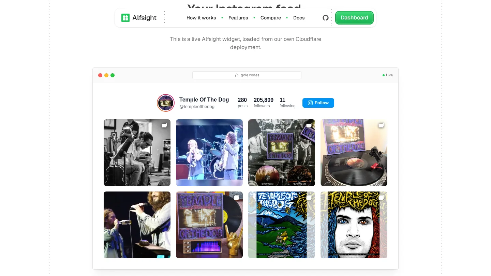

Alfsight is an open-source, self-hosted alternative to Elfsight for Instagram feeds. You set up a feed once in the dashboard, paste one script tag into your site, and it keeps itself fresh. No subscription, and no view limits.

```html
<script src="https://your-domain.com/instagram.js" defer></script>
<instagram-feed feed="YOUR_FEED_ID" api-base="https://your-api.com"></instagram-feed>
```

It works anywhere that renders HTML: plain sites, WordPress, Shopify, Webflow, React, Vue or Next.js.



## How it's built

It's a small monorepo running on Cloudflare's edge:

- **The widget** is a plain Web Component with no framework, under 6 kB gzipped. Its styles live in a Shadow DOM, so it never clashes with the page it's embedded in. It supports one to four columns, captions and a profile header.
- **The API** is a [Hono](https://hono.dev/) app on Cloudflare Workers, with [Drizzle ORM](https://orm.drizzle.team/) on a Cloudflare D1 database.
- **Feeds are cached** in Cloudflare KV, so a page view usually never reaches the database. A scheduled job re-syncs feeds in the background.
- **The dashboard** is a React app where you create feeds, pick a layout and copy the snippet.
- **The landing page** is built with Astro.

Instagram data comes from a provider through the API, and the provider's key stays on the server. It never reaches the browser, the widget or its settings.
