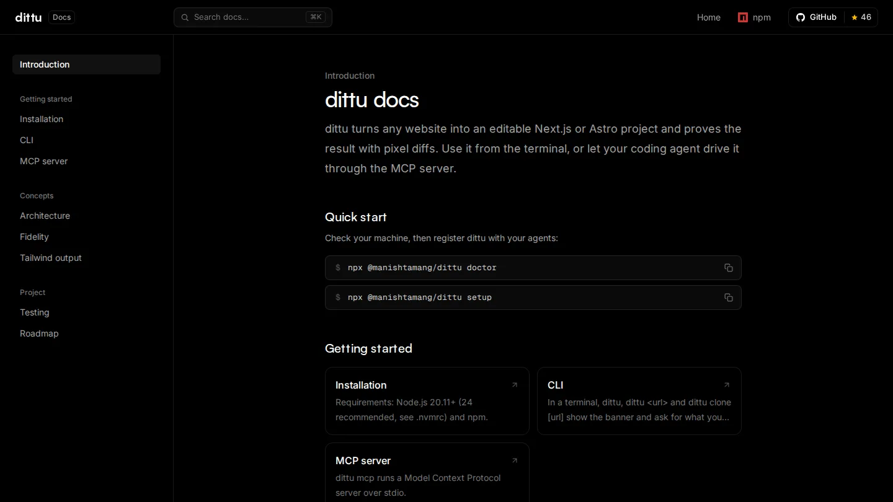

dittu turns any website into an editable Next.js or Astro project, and then checks its own work. It copies the frontend: layout, CSS, fonts, images and scroll animations. Not the backend.

It's published on npm as [`@manishtamang/dittu`](https://www.npmjs.com/package/@manishtamang/dittu), and it works three ways: as a CLI, as an MCP server your coding agent can drive, and through agent skills.

```bash
npx @manishtamang/dittu setup
```

## How it works

Most website cloners screenshot a page and ask an AI model to redraw it. dittu copies what the browser actually rendered instead:

1. **Capture.** Chromium loads the page and scrolls it, so lazy content and scroll reveals fire, then freezes timers so carousels hold still. A second pass at phone width records layout that JavaScript computes per screen size.
2. **Take the live DOM**, not the server HTML, so Next.js and React sites come out as their final markup.
3. **Keep the original CSS** in order, including CSS-in-JS rules, so media queries, hover states and animations keep working.
4. **Download every asset** and rewrite the URLs.
5. **Export** a static preview, a Next.js project and an Astro project, split into section components.
6. **Replay motion** with a 2 KB runtime.
7. **Verify** by screenshotting the original and the clone the same way, on desktop and on mobile, and scoring the difference.

## How close it gets

Score = 1 − differing pixels ÷ total pixels.

| Site | Stack | Desktop | Mobile |
| --- | --- | --- | --- |
| gole.codes | Next.js, heavy animation | 99.95% | 99.89% |
| nextjs.org | Next.js | 99.79% | 99.99% |
| ui.shadcn.com | Next.js + Tailwind | 100% | 100% |
| astro.build | Astro | 100% | 100% |

## The docs

The [website](https://dittu.manishtamang.com/) has the landing page and the docs: installation, the CLI, the MCP server, and how the pipeline and the fidelity scoring work.


