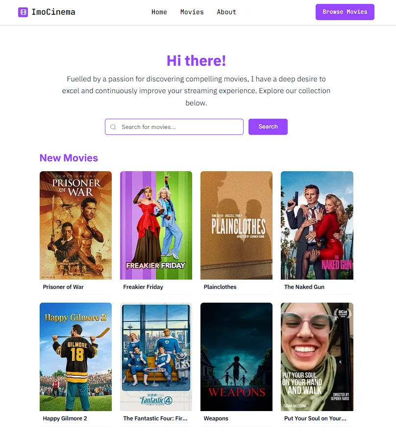
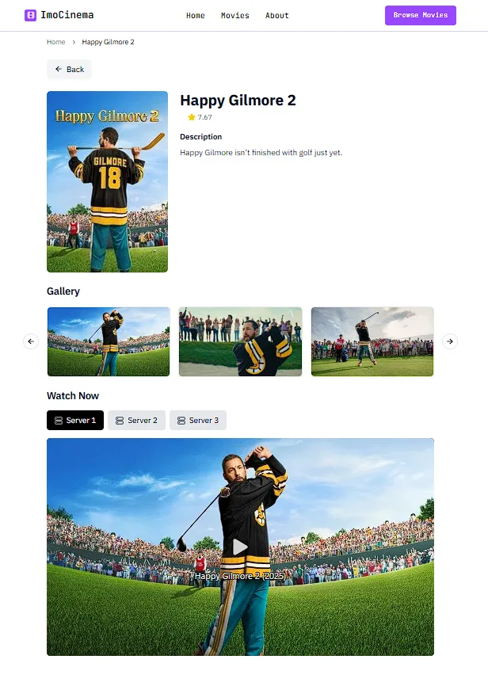

A modern, minimal movie discovery website built with Next.js, featuring a clean UI design and comprehensive movie search functionality.





## ✨ Features

- **Modern UI/UX**: Clean, minimal design with consistent color scheme and typography
- **Responsive Design**: Mobile-first approach with responsive grid layouts
- **Movie Search**: Advanced search functionality with real-time results
- **Movie Discovery**: Browse trending and popular movies
- **Sticky Navigation**: Persistent header with smooth navigation
- **Skeleton Loading**: Elegant loading states with animated placeholders
- **Compact Cards**: Small, efficient movie cards for better browsing experience
- **4-Column Grid**: Optimized layout for desktop and tablet viewing

## 🛠️ Tech Stack

- **Framework**: Next.js 14 (App Router)
- **Language**: TypeScript
- **Styling**: Tailwind CSS
- **UI Components**: Radix UI + Custom Components
- **Icons**: Lucide React
- **State Management**: React Hooks
- **API**: RESTful API with Next.js API Routes

## 🚀 Getting Started

### Prerequisites

- Node.js 18+ 
- pnpm (recommended) or npm

### Installation

1. Clone the repository
```bash
git clone https://github.com/Manish-Tamang/ImoCinema.git
cd ImoCinema
```

2. Install dependencies
```bash
pnpm install
# or
npm install
```

3. Run the development server
```bash
pnpm dev
# or
npm run dev
```

4. Open [http://localhost:3000](http://localhost:3000) in your browser

## 📁 Project Structure

```
ImoCinema/
├── app/                   
│   ├── api/             
│   ├── movie/           
│   ├── search/           
│   └── layout.tsx       
├── components/            
│   ├── ui/               
│   ├── header.tsx       
│   ├── movie-card.tsx     
│   └── footer.tsx        
├── lib/                   
├── public/                
└── styles/                
```

## 🎨 Design Principles

- **Minimalism**: Clean, uncluttered interface
- **Consistency**: Unified color palette and typography
- **Accessibility**: High contrast and readable fonts
- **Performance**: Optimized loading with skeleton states
- **Responsiveness**: Adaptive layouts for all devices


## 📱 Responsive Breakpoints

- **Mobile**: 2 columns (grid-cols-2)
- **Tablet**: 3 columns (sm:grid-cols-3) 
- **Desktop**: 4 columns (md:grid-cols-4)

## 🎯 Key Components

### Header
- Sticky navigation with minimal design
- Responsive mobile menu
- Consistent branding and navigation

### Movie Cards
- Compact, efficient design
- Hover effects and transitions
- Optimized image loading

### Search Interface
- Clean search form with minimal styling
- Real-time search results
- Skeleton loading states


## 🙏 Acknowledgments

- [Milan Bhandari (@milancodess)](https://github.com/milancodess) for the movie scraping logic from Soap2Day

---
