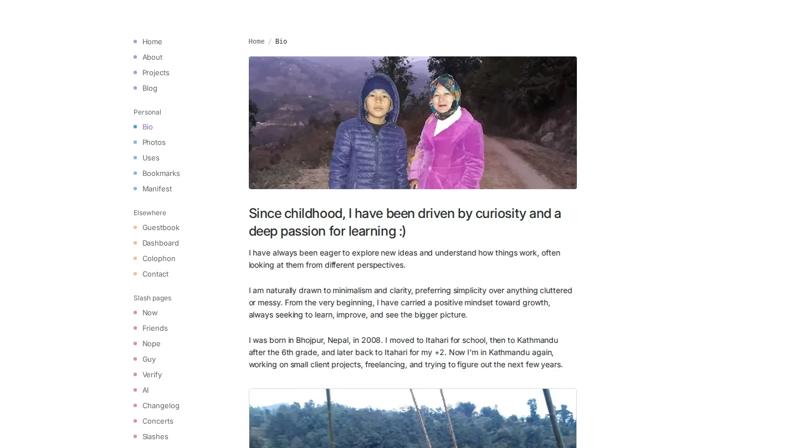

This is the site you're on. I first built it in 2025 with Next.js and Sanity, and in late 2026 I rebuilt it from scratch with Astro.

## Why I rebuilt it

The old site shipped 400 to 800 KB of compressed JavaScript on every page, even ones that were mostly text. I wanted pages that are just HTML and CSS unless something on them actually needs a script.

So the rebuild is mostly static: every page is built ahead of time, except the guestbook and the dashboard, which need live data. Content moved out of Sanity into the repo, as Markdown and MDX next to their images. Every URL from the old site still works.

## What's on it

- **A blog and projects**, written in MDX, with blurred image previews while photos load and an image viewer for every photo.
- **Story pages** like [/bio](/bio) and [/about](/about), laid out as one calm reading column.
- **A guestbook** where you sign in with GitHub or Google and can write with bold, italic, links and code.
- **Blog reactions and view counts** in Supabase, carried over from the old site's Firebase.
- **A [dashboard](/dashboard)** of live stats: coding time, music, GitHub activity and site traffic.
- **Slash pages** such as [/now](/now), [/uses](/uses), [/ai](/ai) and [/changelog](/changelog).

## Small details I care about

- The type is Inter, tuned per size, with line heights on whole pixels so text lines up.
- Selecting text draws a rounded marker highlight instead of the browser's default.
- Photos are optimized at build time, with phone-sized crops where it matters.

## How fast it is

On PageSpeed Insights the home page scores 100 on desktop and 96 on a throttled mobile connection, and it weighs well under 1 MB.
