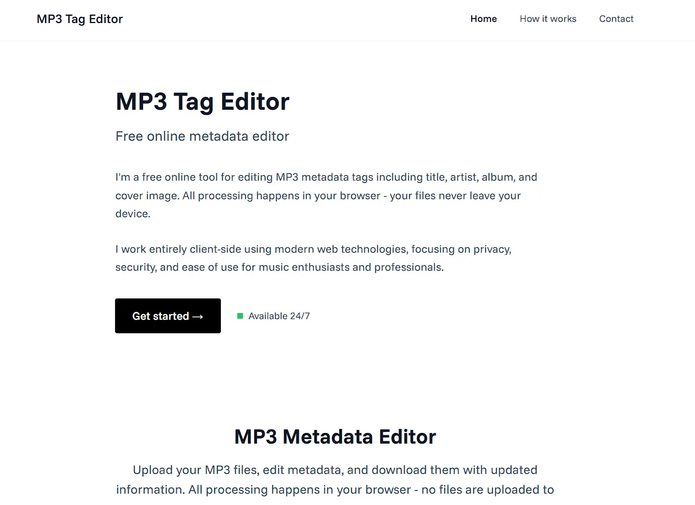
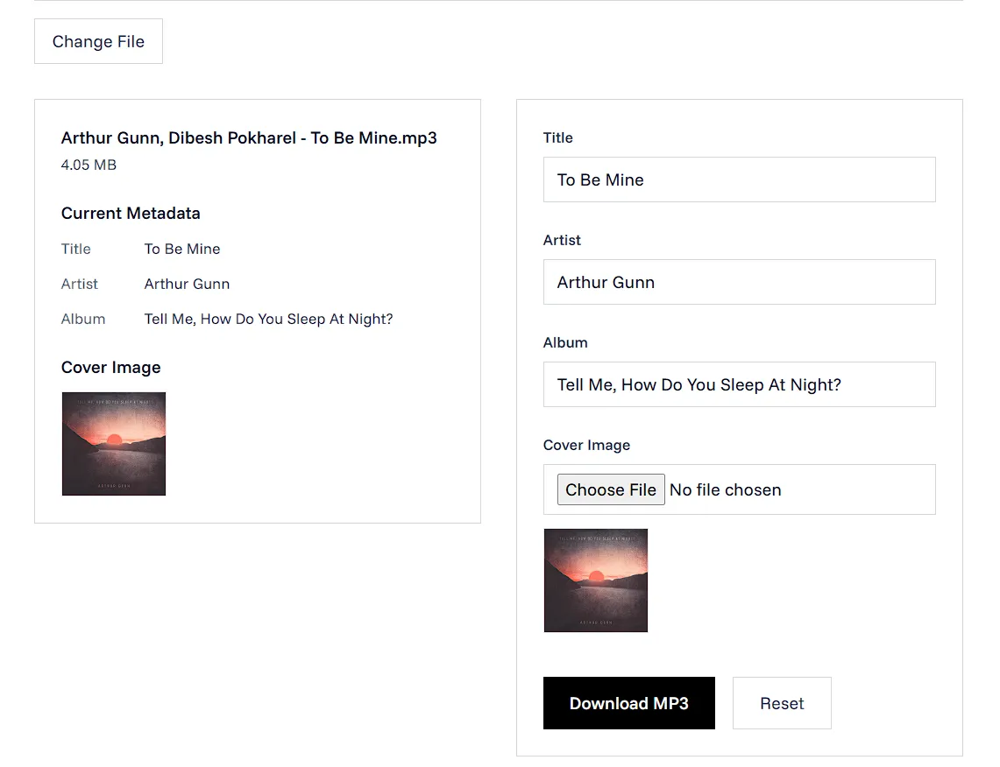

A modern, client-side MP3 metadata editor built with Next.js and TypeScript. Edit MP3 file tags including title, artist, album, and cover image directly in your browser without uploading files to any server.




## ✨ Features

- **Client-side Processing**: All file processing happens in your browser - your files never leave your device
- **Metadata Editing**: Edit title, artist, album, and cover image
- **Real-time Preview**: See current metadata before making changes
- **Cover Image Support**: Upload and replace album artwork
- **Privacy First**: No server-side file storage or processing
- **Modern UI**: Clean, minimal design with Funnel Sans typography
- **Cross-platform**: Works on any device with a modern web browser

## 🛠️ Tech Stack

- **Frontend**: Next.js 15, React 19, TypeScript
- **Styling**: Tailwind CSS
- **Fonts**: Funnel Sans (Google Fonts)
- **MP3 Processing**: music-metadata (reading), browser-id3-writer (writing)
- **Icons**: Lucide React
- **UI Components**: Custom minimal design components

## 🚀 Getting Started

### Prerequisites

- Node.js 18+ 
- npm, yarn, or pnpm

### Installation

1. **Clone the repository**
   ```bash
   git clone https://github.com/Manish-Tamang/mp3-metadata-editor.git
   cd mp3-metadata-editor
   ```

2. **Install dependencies**
   ```bash
   npm install
   # or
   yarn install
   # or
   pnpm install
   ```

3. **Run the development server**
   ```bash
   npm run dev
   # or
   yarn dev
   # or
   pnpm dev
   ```

4. **Open your browser**
   Navigate to [http://localhost:3000](http://localhost:3000)

### Building for Production

```bash
npm run build
npm start
```

## 📁 Project Structure

```
mp3-metadata-editor/
├── app/                  
│   ├── contact/          
│   ├── how-it-works/    
│   ├── globals.css     
│   ├── layout.tsx         
│   └── page.tsx          
├── components/           
│   ├── ui/               
│   ├── FileUpload.tsx    
│   ├── Footer.tsx       
│   ├── HeroSection.tsx  
│   ├── MetadataForm.tsx   
│   ├── MetadataPreview.tsx 
│   ├── Navbar.tsx        
│   └── UploadForm.tsx   
├── hooks/                 
│   └── useMp3Metadata.ts 
├── lib/                  
│   ├── id3.ts            
│   └── utils.ts           
├── public/               
└── styles/                
```

## 🔧 How It Works

### 1. File Upload
- Users drag & drop or select MP3 files
- File validation ensures only MP3 files are accepted
- File size and name are displayed

### 2. Metadata Reading
- Uses `music-metadata` library to parse existing ID3 tags
- Extracts title, artist, album, and cover image
- Displays current metadata in a clean preview

### 3. Metadata Editing
- Users can modify title, artist, and album fields
- Upload new cover images to replace existing artwork
- Real-time preview of changes

### 4. File Download
- Uses `browser-id3-writer` to write new metadata
- Creates a new MP3 file with updated tags
- Downloads the modified file with new filename

## 🎨 Design Philosophy

- **Minimal**: Clean, distraction-free interface
- **Typography**: Funnel Sans font for excellent readability
- **No Curves**: Sharp, geometric design elements
- **No Shadows**: Flat, modern aesthetic
- **Accessibility**: High contrast and clear visual hierarchy

## 🔒 Privacy & Security

- **Zero Server Storage**: Files are processed entirely in your browser
- **No Tracking**: No analytics or user behavior tracking
- **Open Source**: Transparent codebase for security review
- **Client-side Only**: All processing happens locally

## 🐛 Troubleshooting

### Common Issues

1. **"ID3Writer is not a constructor"**
   - Ensure `browser-id3-writer` is properly installed
   - Check browser console for detailed error messages

2. **Metadata not displaying**
   - Verify the MP3 file has embedded ID3 tags
   - Check browser console for parsing errors

3. **Cover image not showing**
   - Ensure the image file is a valid image format
   - Check file size (large images may cause issues)


## 🙏 Acknowledgments

- Built with [Next.js](https://nextjs.org/)
- Styled with [Tailwind CSS](https://tailwindcss.com/)
- MP3 processing with [music-metadata](https://github.com/Borewit/music-metadata) and [browser-id3-writer](https://github.com/egoroof/browser-id3-writer)
- Icons from [Lucide React](https://lucide.dev/)

---

Made with ❤️ by [Manish Tamang](https://www.manishtamang.com)
