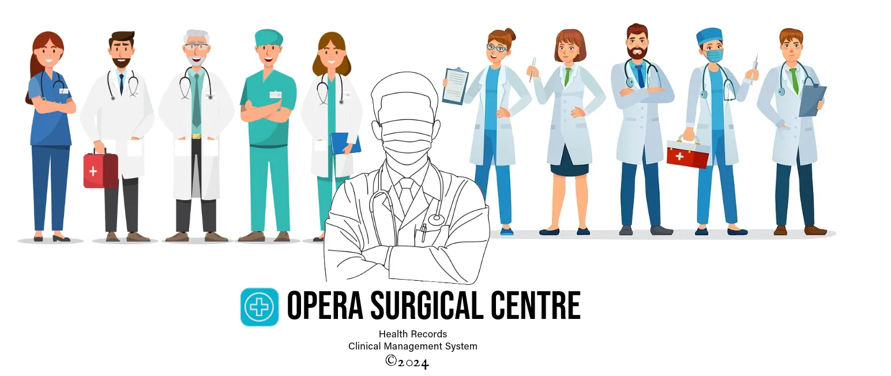
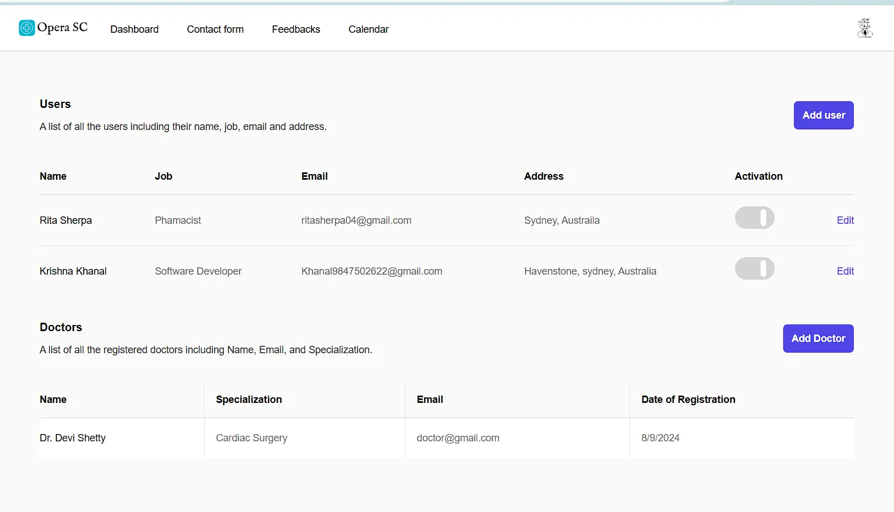
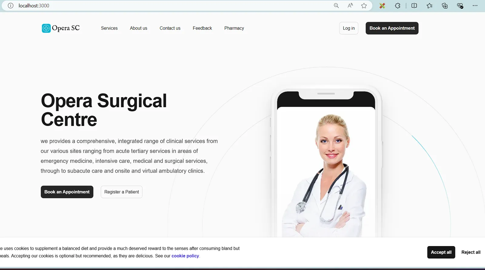
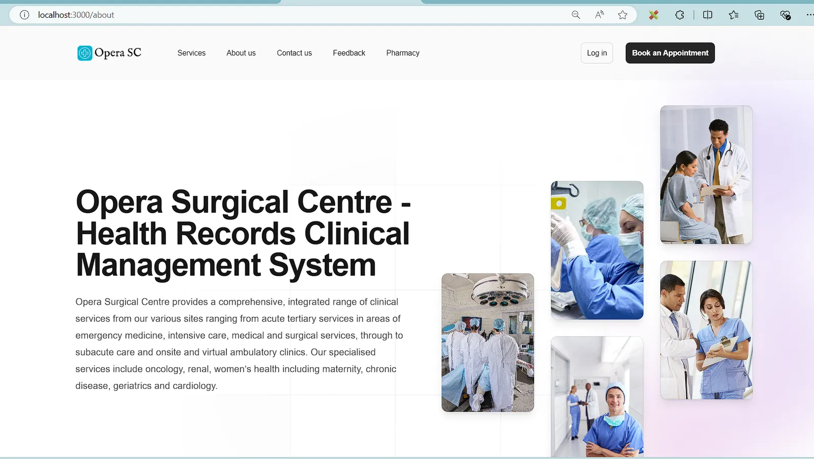
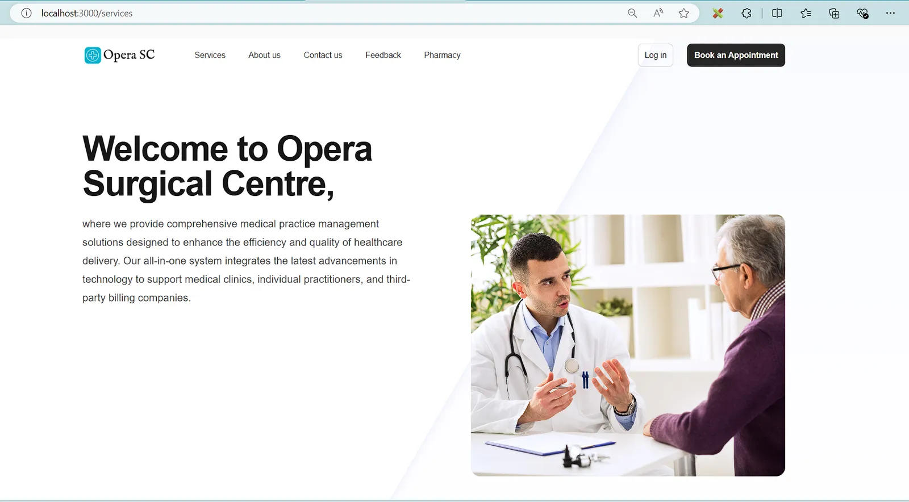
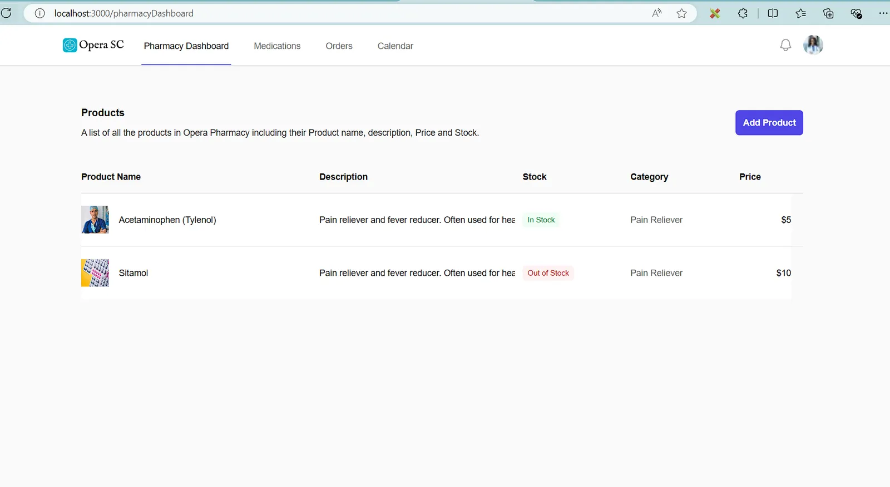
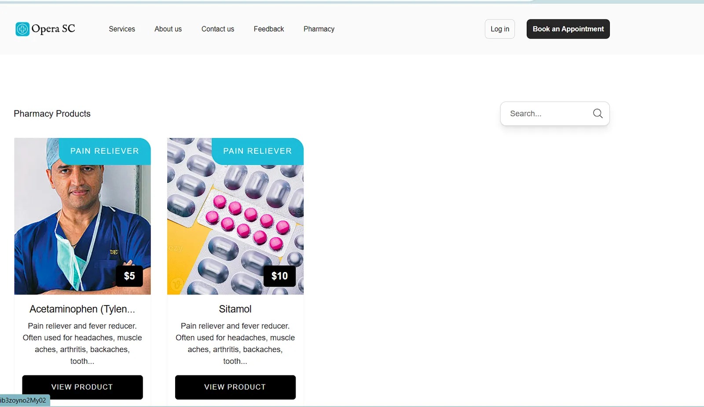
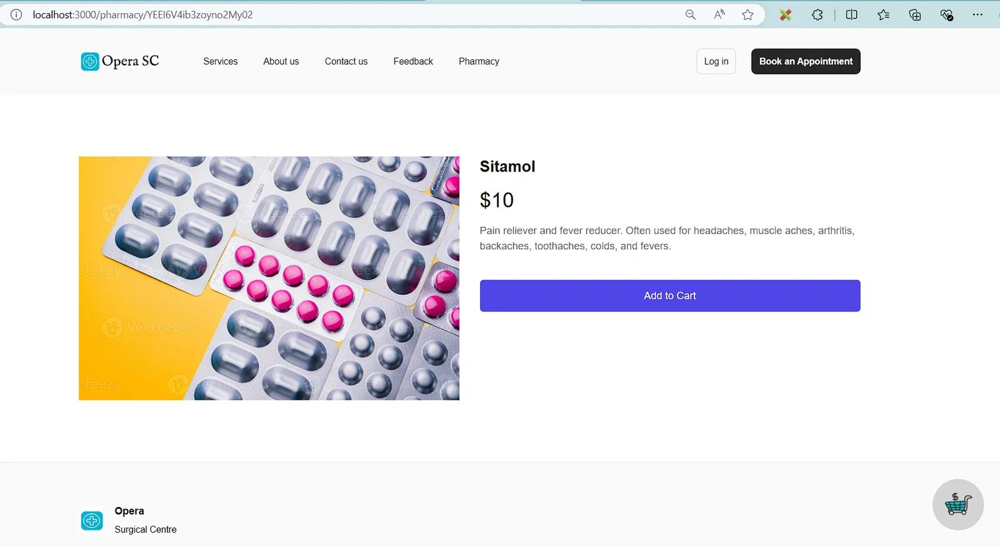
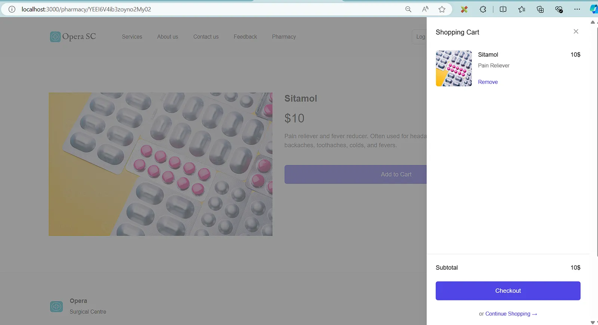

A college assignment to create a clinic management system.

## Tech Stack

**Client:** Nextjs, React, TailwindCSS, Typescript

**Server:** Node, Firebase, Nodemailer

## Features

- Dashboard, Doctor Dashboard, Pharmacy Dashboard
- Higher Ordered Components for Security
- Firebase Authentication
- Role Base Login system
- Contact from, feedback form etc.
- Appointment Registration, Patient Registration and handeling
- Dynamic Email using Nodemailer to User
- Custom Calender
- Account Activation logic etc.
- Pharmacy Ecommerce store.
- Custom Loader

## Environment Variables

To run this project, you will need to add the following environment variables to your .env file

`FIREBASE_PROJECT_ID`=

`FIREBASE_CLIENT_EMAIL`=

`FIREBASE_PRIVATE_KEY`=

`GMAIL_USER`=

`GMAIL_PASS`=

`NEXT_PUBLIC_FIREBASE_API_KEY`=

`NEXT_PUBLIC_FIREBASE_AUTH_DOMAIN`=

`NEXT_PUBLIC_FIREBASE_PROJECT_ID`=

`NEXT_PUBLIC_FIREBASE_STORAGE_BUCKET`=

`NEXT_PUBLIC_FIREBASE_MESSAGING_SENDER_ID`=

`NEXT_PUBLIC_FIREBASE_APP_ID`=

## Screenshots



















## Run Locally

Clone the project

```bash
  git clone https://github.com/Manish-Tamang/opera-surgical-centre
```

Go to the project directory

```bash
  cd opera-surgical-centre
```

Install dependencies

```bash
  npm install
```

Start the server

```bash
  npm run dev
```
