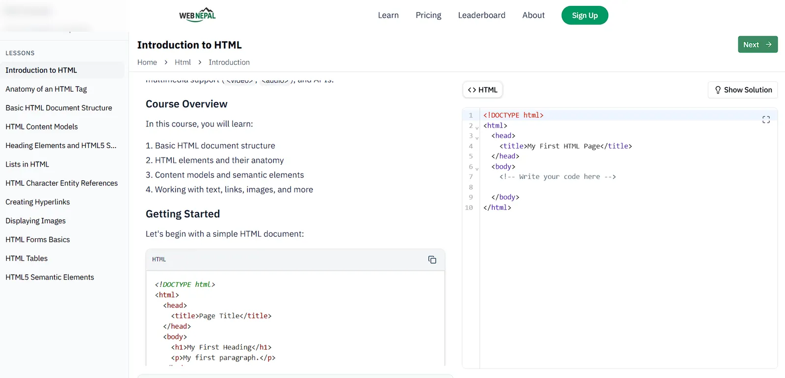

<div align="center">


**by Team Godawari**

</div>

A modern web development learning platform that combines interactive coding lessons with AI-powered feedback to help students learn by doing.


## About

Web Nepal is an innovative learning platform designed to teach web development through hands-on coding exercises. Students can practice HTML, CSS, JavaScript, and other web technologies with real-time feedback and AI assistance.

### Key Features

- **Interactive Coding Lessons** - Learn by writing actual code
- **AI-Powered Feedback** - Get instant suggestions and improvements
- **Progress Tracking** - Monitor your learning journey
- **Multiple Topics** - HTML, CSS, JavaScript, and more
- **Live Code Preview** - See your code in action immediately

## Screenshots

### Homepage


### Learning Interface


## Getting Started

1. Install dependencies:

```bash
npm install
```

2. Run the development server:

```bash
npm run dev
```

3. Open [http://localhost:3000](http://localhost:3000) to view the application

## Tech Stack

- **Next.js 15** - React framework
- **TypeScript** - Type safety
- **Tailwind CSS** - Styling
- **Google Gemini AI** - AI feedback
- **Prisma** - Database ORM
- **NextAuth.js** - Authentication

## Hackathon Info

This project was built in **12 hours** for **Cyber Utsav 2.0 Regional Hackathon** in Itahari.

**Team Godawari:**

- [Manish Tamang](https://github.com/Manish-Tamang)
- [NuxGajurel](https://github.com/NuxGajurel)

## License

This project is created for educational purposes as part of the hackathon.
